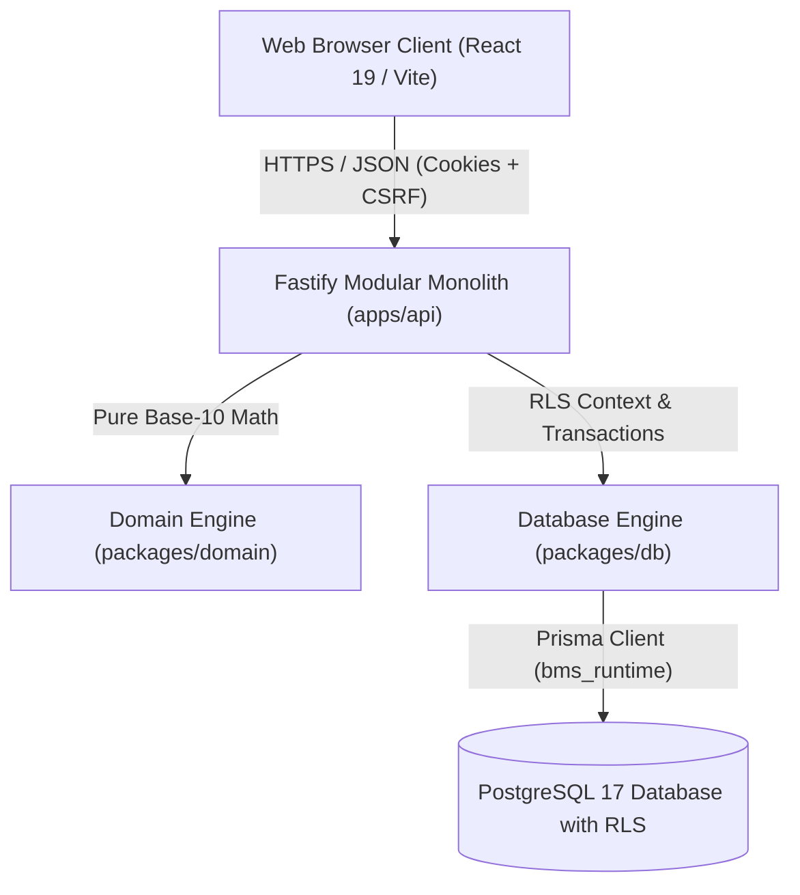

# Architecture, Code Flow & Milestone Phases

## 1. Architectural Principles & Philosophy

This application is designed as an **online-first, multi-tenant modular monolith** for business management, billing, inventory control, and double-entry accounting (inspired by modern business software like Vyapar, but built ground-up with strict financial integrity).



### Core Invariants

1. **Strict Multi-Tenant Isolation**:
   - Every table has a `business_id` column with composite foreign keys `(business_id, ...)`.
   - PostgreSQL Row Level Security (RLS) is enabled and forced (`FORCE ROW LEVEL SECURITY`) on all business tables.
   - The application interacts with the database using a restricted runtime user (`bms_runtime`) that cannot bypass RLS.
2. **Zero Floating-Point Arithmetic**:
   - All monetary figures, quantities, unit conversions, and tax calculations use exact arbitrary-precision base-10 arithmetic (`Decimal` / `bigint` / `@business/domain`).
   - JavaScript native `Number` floats are strictly prohibited for financial logic.
3. **Atomic Multi-Effect Posting**:
   - When a sale or purchase command is posted, a single database transaction atomically creates:
     - The business document (`sale_documents` or `purchase_documents`) with sequential numbering (`INV-XXXXXX`, `PB-XXXXXX`).
     - Line items and payments with exact currency allocation.
     - Inward/outward stock ledger movements with moving weighted-average valuation.
     - Balanced double-entry journal entries (Total Debits = Total Credits).
     - Audit event and commit-ordered sync change batch.
4. **Online Server Authority**:
   - The server is the authoritative source for sequential numbering, journal posting, and inventory valuation.
   - Unsaved client drafts remain in client state as resilient retries, while legacy pre-cutover offline records are held in partitioned IndexedDB stores strictly for authorized encrypted recovery.

---

## 2. End-to-End Code Flow

### A. Frontend Layer (`apps/web`)

- **Entry & Shell** ([`App.tsx`](file:///c:/Users/HP/Desktop/buisness%20management%20system/apps/web/src/App.tsx), [`Shell.tsx`](file:///c:/Users/HP/Desktop/buisness%20management%20system/apps/web/src/components/Shell.tsx)):
  - Global navigation and routing for Home, Sales, Purchases, Parties, Items, Cash & Bank, Settings.
  - Global shortcuts:
    - `Ctrl+K` / `Cmd+K`: Command Palette.
    - `Alt+S`: Quick Navigate to New Sale.
    - `Alt+P`: Quick Navigate to New Purchase Bill.
    - `Ctrl+Enter` / `Cmd+Enter`: Instant Post/Save on Sale and Purchase screens.
- **Authentication & Tenant State** ([`AuthContext.tsx`](file:///c:/Users/HP/Desktop/buisness%20management%20system/apps/web/src/context/AuthContext.tsx)):
  - Stores authenticated user, active business membership, and `csrfToken`.
  - Automatically attaches `x-csrf-token` header to all mutation requests (`POST`, `PUT`, `PATCH`, `DELETE`).
- **Billing & Document Pages** ([`apps/web/src/pages/`](file:///c:/Users/HP/Desktop/buisness%20management%20system/apps/web/src/pages/)):
  - `NewSalePage.tsx`: Live sales register with barcode/item search, live tax/discount recalculations, cash/bank split, and instant posting.
  - `SalesPage.tsx`: Paged sales directory with search, status filters, and snapshot print modal.
  - `NewPurchasePage.tsx`: Inward purchase bill entry with supplier invoice reference, unit conversions, unit costs, cash/bank split, duplicate reference protection, and draft saving.
  - `PurchasesPage.tsx`: Paged inward bill directory with supplier payable tracking and receipt details.
  - `DirectoryPage.tsx`: Catalogue manager for Goods, Services, Customers, and Suppliers.
  - `AccountSetupPage.tsx` & `MoneyTransferPanel.tsx`: Chart of accounts and cash/bank transfers.

### B. API Routing Layer (`apps/api/src/routes/`)

`apps/api/src/app.ts` assembles modular sub-routes organized into dedicated domain files:

| Route Module | Endpoints | Responsibilities |
| --- | --- | --- |
| [`routes/health.ts`](file:///c:/Users/HP/Desktop/buisness%20management%20system/apps/api/src/routes/health.ts) | `/health/live`, `/health/ready` | Liveness and real PostgreSQL readiness health checks. |
| [`routes/auth.ts`](file:///c:/Users/HP/Desktop/buisness%20management%20system/apps/api/src/routes/auth.ts) | `/v1/auth/register`, `/v1/auth/login`, `/v1/auth/me`, `/v1/auth/select-business`, `/v1/auth/change-password`, `/v1/auth/sessions` | Multi-tenant user auth, session token cookies, rate-limiting, and password hashing. |
| [`routes/devices.ts`](file:///c:/Users/HP/Desktop/buisness%20management%20system/apps/api/src/routes/devices.ts) | `/v1/locations`, `/v1/devices/enroll`, `/v1/devices/revoke`, `/v1/devices/lease` | Device enrollment, number prefix assignment, and signed offline leases. |
| [`routes/sales.ts`](file:///c:/Users/HP/Desktop/buisness%20management%20system/apps/api/src/routes/sales.ts) | `/v1/sales/workspace`, `/v1/sales/drafts`, `/v1/sales/:id/post`, `/v1/sales/documents` | Live sales workspace, draft idempotency, atomic posting, and document history. |
| [`routes/purchases.ts`](file:///c:/Users/HP/Desktop/buisness%20management%20system/apps/api/src/routes/purchases.ts) | `/v1/purchases/workspace`, `/v1/purchases/drafts`, `/v1/purchases/:id/post`, `/v1/purchases/documents` | Inward supplier bills, tax/discount calculation, duplicate reference protection, and stock receipt. |
| [`routes/catalogue.ts`](file:///c:/Users/HP/Desktop/buisness%20management%20system/apps/api/src/routes/catalogue.ts) | `/v1/catalogue/items`, `/v1/catalogue/parties`, `/v1/catalogue/setup`, `/v1/catalogue/conversions` | Master data items, units, tax profiles, unit conversions, and provisional parties. |
| [`routes/accounts.ts`](file:///c:/Users/HP/Desktop/buisness%20management%20system/apps/api/src/routes/accounts.ts) | `/v1/accounts/setup`, `/v1/accounts/transfers`, `/v1/accounts/books/:id`, `/v1/accounts/system` | Account books, cash/bank transfers, system accounts, and ledger pagination. |
| [`routes/opening.ts`](file:///c:/Users/HP/Desktop/buisness%20management%20system/apps/api/src/routes/opening.ts) | `/v1/opening/preview`, `/v1/opening/commit` | One-time opening balance preview and idempotent double-entry balance posting. |
| [`routes/sync.ts`](file:///c:/Users/HP/Desktop/buisness%20management%20system/apps/api/src/routes/sync.ts) | `/v1/sync/bootstrap`, `/v1/sync/pull`, `/v1/sync/push/sale` | Sync cursor advancement and `410 OFFLINE_RETIRED` cutover guard. |

### C. Domain & Calculation Layer (`packages/domain`)

- `calculateDocument`:
  - Computes line base amount: $\text{qty} \times \text{unitCost} - \text{lineDiscount}$.
  - Computes tax amounts for Inclusive vs. Exclusive tax modes with half-up rounding.
  - Allocates document-level discounts proportionally across lines preserving exact penny totals.
  - Splits payment between Cash Applied, Bank Applied, Cash Tendered, Change Due, and Remaining Payable/Receivable.

### D. Database & Posting Layer (`packages/db`)

- **PostgreSQL Context & RLS**:
  - `withTenantContext(client, { businessId, userId }, callback)`:
    - Sets session configuration variables:
      ```sql
      SET LOCAL app.current_business_id = '<businessId>';
      SET LOCAL app.current_user_id = '<userId>';
      ```
    - Guarantees PostgreSQL RLS filters all rows at the database engine level.
- **Ordered Sync Cursor**:
  - `withBusinessChange`: Obtains row lock on `sync_heads` before allocating an ordered commit cursor. Ordinary sequences are never used as sync cursors.
- **Double-Entry Posting Engine** ([`posting.ts`](file:///c:/Users/HP/Desktop/buisness%20management%20system/packages/db/src/posting.ts)):
  - Validates balance equation:
    $$\sum \text{Debits} = \sum \text{Credits}$$
  - Inserts `source_events`, `journal_entries`, and `journal_lines` atomically with the command receipt.

---

## 3. Milestone Delivery Phases & Roadmap

```mermaid
flowchart LR
    M00["M00 Architecture"] --> M01["M01 Shell & Setup"]
    M01 --> M02["M02 Identity & RLS"]
    M02 --> M03["M03 Posting Engine"]
    M03 --> M04["M04 Master Data & Opening"]
    M04 --> M05["M05 Online Billing"]
    M05 --> M06["M06 Web Cutover"]
    M06 --> M07["M07 Purchases & Money"]
    M07 --> M08["M08 Returns & Lifecycle"]
    M08 --> M09["M09 Reports & Audit"]
```



### Phase Summary

| Phase | Title | Status | What Was Delivered |
| --- | --- | --- | --- |
| **M00** | Product Plan & Specs | **Complete** | Roadmap, architecture specifications, domain models, and prompt contracts. |
| **M01** | Foundation & Shell | **Complete** | Monorepo layout, pnpm workspaces, React/Tailwind shell, Fastify health checks, responsive viewport tests. |
| **M02** | Identity & Security | **Complete** | Username auth, sessions, PostgreSQL RLS under restricted `bms_runtime`, composite foreign keys, device enrollment. |
| **M03** | Domain & Journal Engine | **Complete** | Base-10 exact arithmetic, double-entry journal dispatcher, audit events, commit-ordered sync cursors. |
| **M04** | Master Data & Opening | **Complete** | Items, categories, alternate unit conversions, tax profiles, parties, setup UI, and previewed opening balance posting. |
| **M05** | Online Sales & Billing | **Complete** | Live sales billing, sequential invoice numbers (`INV-XXXXXX`), atomic inventory deduction, and customer dues. |
| **M06** | Online Web Cutover | **Complete** | Transitioned system to online authority; retired offline intake (`410 OFFLINE_RETIRED`), preserved encrypted recovery for legacy browser work. |
| **M07** | Purchases & Money Transfers | **In Progress** | **Increment 1 (PR #17)**: Cash/Bank money transfers with source-cash guards and account books.<br>**Increment 2 (`c9480a0`)**: Purchase bills with supplier references, unit conversions, moving weighted-average valuation, balanced journals, duplicate reference protection, and listing UI. |
| **M08** | Returns & Inventory Lifecycle | *Planned* | Sales returns, credit notes, purchase returns, debit notes, and inventory write-offs/adjustments. |
| **M09** | Reports & Reconciliation | *Planned* | Profit & loss, balance sheet, trial balance, stock valuation ledger, party statements, and tax reports. |

---

## 4. Developer Verification & Quality Gates

Before opening PRs or merging code, all standard validation gates must be run and passing:

```bash
# 1. Typecheck, lint, build all workspace packages & run 26 unit tests
pnpm check

# 2. Verify compiled server runtime startup against real DB readiness
pnpm test:runtime

# 3. Verify all 11 PostgreSQL integration tests (tenant isolation, RLS, posting, sales, transfers, purchases)
pnpm test:db

# 4. Verify all 21 Playwright browser end-to-end tests against built production preview
pnpm test:e2e
```
