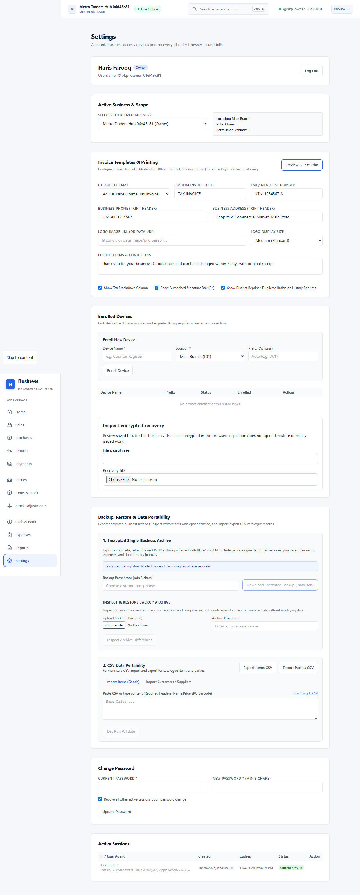
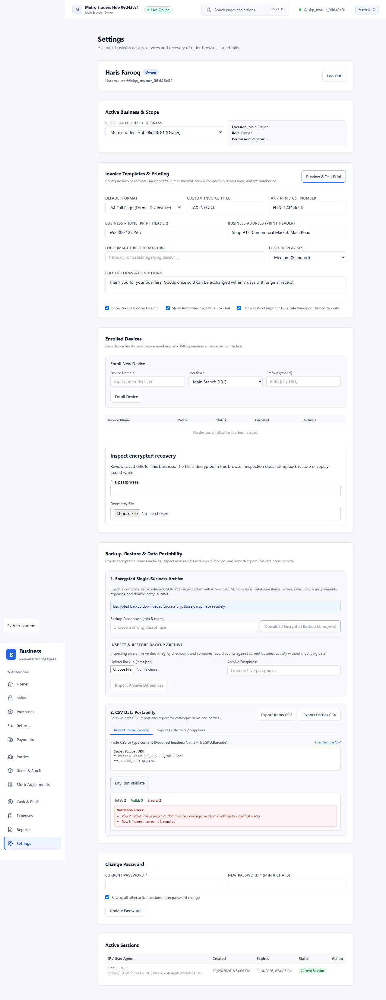
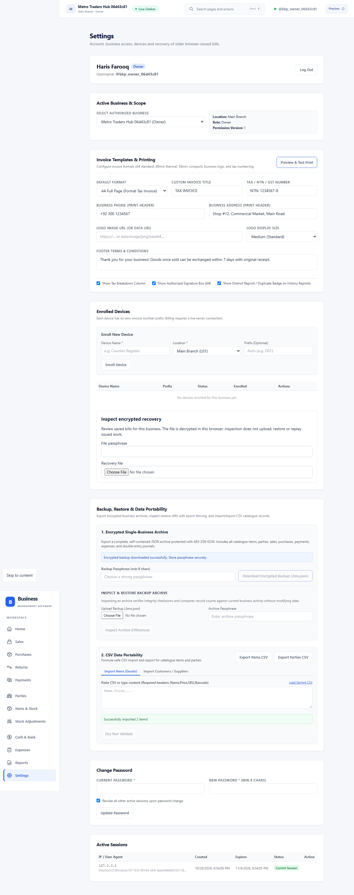

# Milestone 11 Evidence: Tenant Backup Archives, Epoch Fencing, CSV Portability & Operations

## 1. Overview & Scope
Milestone 11 completes owner-authorized single-business disaster recovery, cryptographic archival, epoch fencing, formula-safe data portability, and production operational runbooks:

1. **Encrypted Archive Envelope (`AES-256-GCM`)**:
   - Single-business complete export encompassing locations, accounts, catalogue items, conversions, parties, journal entries, stock movements, sales, purchases, payments, expenses, returns, adjustments, cash sessions, and command receipts.
   - Key derivation using `PBKDF2-HMAC-SHA256` (100,000 iterations, 32-byte salt).
   - Control totals computed: total debits, total credits, stock valuation, and per-entity record counts.
   - SHA-256 payload integrity checksum in manifest.
2. **Safe Restore & Epoch Fencing**:
   - **Non-destructive Inspection Preview**: Compares archive record counts with current business counts without modifying database state. Rejects archives with incorrect passphrases or cross-tenant business IDs (403 Forbidden).
   - **Atomic Promotion**: Increments `datasetEpoch` on `Business` and `SyncHead`.
   - **Device & Session Revocation**: Enrolled devices are revoked and existing browser sessions for the business are invalidated.
   - **Epoch Gate Enforcement**: Any device or offline client attempting to post commands with a stale epoch is rejected by the database sync-head lock (`Dataset epoch mismatch`).
3. **Formula-Safe CSV Portability**:
   - Sanitizes fields starting with `=, +, -, @, \t, \r` by prepending a single quote (`'`) on export, mitigating Excel/LibreOffice DDE macro execution vulnerabilities.
   - Dry-run validation API and UI returning row-level errors (missing required fields, negative prices, duplicate names or SKUs) prior to database insertion.
   - Idempotent batch commit with audit event tracking: repeated submissions with the same `batchId` return existing count without duplicate insertion.
4. **Production Runbooks**:
   - `docs/runbooks/deployment-and-operations.md`: Topology, configuration schema, zero-downtime locked migration deploy process, health probes, connection pool sizing, and backup cadence.
   - `docs/runbooks/incident-and-recovery.md`: RPO $\le 24$h / RTO $\le 4$h targets, lost device immediate revocation, corrupted database point-in-time recovery with dataset epoch fence advance, and formula injection incident handling.

---

## 2. Evidence Screenshots

### 01. Encrypted Backup Export & Settings UI

*Figure 1: Owner exports single-business encrypted `.bms.json` archive with custom PBKDF2 passphrase and SHA-256 manifest.*

### 02. CSV Dry-Run Validation with Error Reporting

*Figure 2: Dry-run parser catches invalid price format and missing item names before committing to database.*

### 03. CSV Batch Commit Success & Catalogue Integration

*Figure 3: Clean CSV import batch committed idempotently and instantly visible in live item catalogue.*

---

## 3. Verification Test Results

### DB Integration Test Suite (`tests/backup-restore-db.test.ts`)
- **Encrypted Archive Export**: Verifies `AES-256-GCM` ciphertext, IV, PBKDF2 salt, and SHA-256 checksum.
- **Wrong Passphrase Rejection**: Throws 400 Bad Request on invalid decryption key or corrupted ciphertext.
- **Cross-Tenant Isolation**: BizB cannot inspect or restore BizA's backup envelope (403 Forbidden).
- **Dataset Epoch Fencing**: Promotion advances epoch from 1 to 2; posting commands with epoch 1 fails with `Dataset epoch mismatch`.
- **Formula Injection Mitigation**: Fields starting with `=Formula Party` sanitized to `'=Formula Party` on CSV export.
- **Batch Idempotency**: Re-committing an item batch with the same `batchId` is acknowledged without duplicating rows.

### Workspace Verification Gate
- `pnpm check`: Clean (ESLint 0 warnings, TypeScript 0 errors, 29/29 domain unit tests passed).
- `pnpm test:db`: 16/16 database suites passed under restricted `bms_runtime` role with real PostgreSQL RLS.
- `pnpm test:e2e`: 26/26 Playwright browser specs passed.
