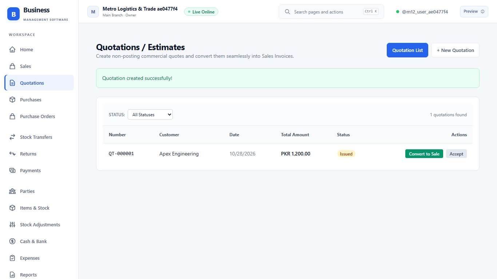
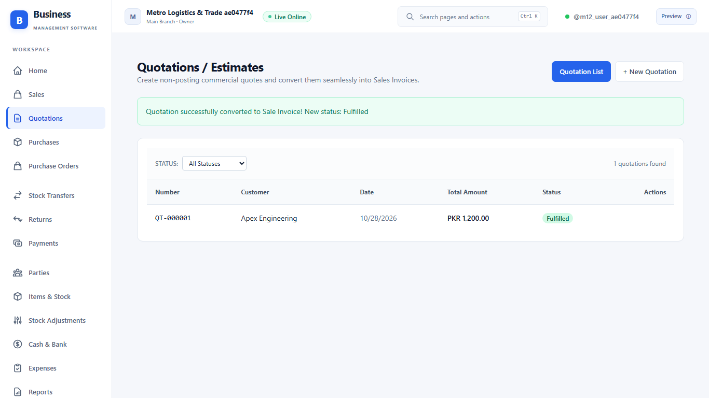
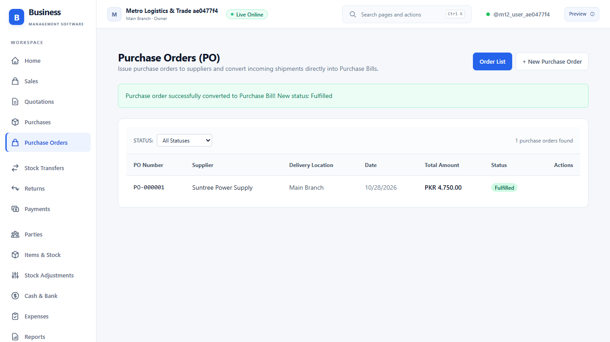
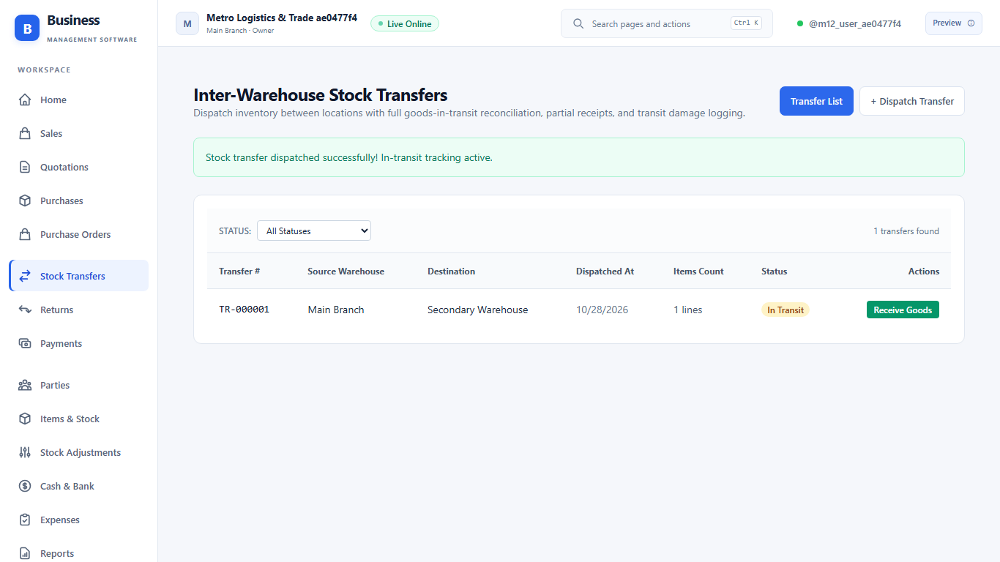
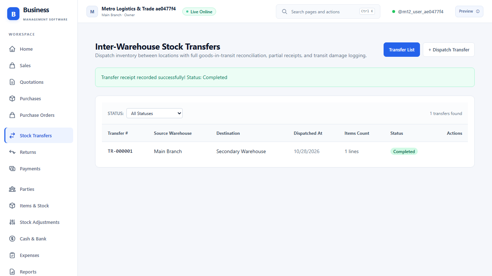

# Milestone 12 Evidence: Quotations, Purchase Orders & Warehouse Transfers

## 1. Milestone Overview

Milestone 12 delivers the full commercial workflow across:
1. **Quotations / Estimates (`Quotation`, `QuotationLine`)**:
   - Non-posting commercial documents with states: `Draft`, `Issued`, `Accepted`, `Expired`, `PartiallyFulfilled`, `Fulfilled`, `Closed`.
   - Issuing or expiring quotations produces zero ledger or stock effects.
   - Partial or complete conversion into standard Sales Invoices (`postSale`) tracking converted vs remaining quantities; over-conversion is strictly prevented.
2. **Purchase Orders (`PurchaseOrder`, `PurchaseOrderLine`)**:
   - Non-posting purchasing commitments with supplier references and expected delivery dates.
   - Conversion into standard Purchase Bills (`postPurchase`), restocking inventory and creating Accounts Payable dues.
3. **Inter-Warehouse Stock Transfers (`StockTransfer`, `StockTransferLine`)**:
   - Two-step inventory transfer between locations of the same business.
   - **Step 1: Dispatch**: Decrements origin warehouse stock at current moving average cost and tracks goods-in-transit. Net asset value and revenue impact is strictly zero (no phantom revenue or VAT between branches).
   - **Step 2: Receipt**: Destination warehouse receives goods into stock. Approved transit damage/loss requires a mandatory reason and posts an inventory loss expense (`INVENTORY_LOSS`) credit to inventory asset.

---

## 2. Database & Migration Layer (`packages/db`)

- **Additive PostgreSQL Migration**: `packages/db/prisma/migrations/20261028000000_m12_quotes_orders_and_transfers/migration.sql`
- **Schema Updates**:
  - Sequential counters on `businesses`: `quotation_sequence`, `purchase_order_sequence`, `stock_transfer_sequence`.
  - Tables created:
    - `quotations` & `quotation_lines`
    - `purchase_orders` & `purchase_order_lines`
    - `stock_transfers` & `stock_transfer_lines`
  - Strict composite tenant foreign keys `(business_id, id)` and unique number constraints.
  - PostgreSQL Row Level Security (RLS) enabled and forced with `tenant_scope` policies.
  - Granted permissions to `bms_runtime`.

---

## 3. Domain Calculation Core (`packages/domain`)

- `packages/domain/src/quotes-and-transfers.ts`:
  - Exact decimal arithmetic (6 decimal places) for quantity calculations.
  - `validateQuoteConversion`: Computes converted vs remaining quantities, validates bounds, and updates status to `PartiallyFulfilled` or `Fulfilled`.
  - `validatePurchaseOrderConversion`: Computes and enforces conversion limits into purchase bills.
  - `validateStockTransferReceipt`: Validates goods-in-transit reconciliation, enforces mandatory loss reasons on transit damage, and determines `PartiallyReceived` or `Completed` statuses.
- **Unit Tests**: `tests/quotes-domain.test.ts` (7 tests, all passing).

---

## 4. Backend API Layer (`apps/api`)

- **Domain Engines**:
  - `apps/api/src/quotes.ts`: Lifecycle management and conversion to sales invoices.
  - `apps/api/src/purchase-orders.ts`: Lifecycle management and conversion to purchase bills.
  - `apps/api/src/stock-transfers.ts`: Atomic sync-head locked stock dispatch and goods-in-transit receipt with transit loss posting.
- **Fastify Modular Routes**:
  - `apps/api/src/routes/quotes.ts`
  - `apps/api/src/routes/purchase-orders.ts`
  - `apps/api/src/routes/stock-transfers.ts`
  - `POST /v1/locations` added to `apps/api/src/routes/devices.ts` for warehouse management.

---

## 5. Frontend Web UI (`apps/web`)

- `apps/web/src/pages/QuotesPage.tsx`: Status badges, item lookup, line math, and Convert to Sale Invoice modal.
- `apps/web/src/pages/PurchaseOrdersPage.tsx`: Supplier selection, expected delivery, and Convert to Purchase Bill modal.
- `apps/web/src/pages/StockTransfersPage.tsx`: Origin/destination warehouses, dispatch form, transit status badges, and Receive Goods modal with transit loss & reason logging.
- Routes added to `App.tsx` (`/quotes`, `/purchase-orders`, `/stock/transfers`) and navigation sidebar icons in `Shell.tsx`.

---

## 6. Verification Evidence

### Workspace Quality Gate (`pnpm check`)
```
> business-management-system@0.1.0 check
> pnpm lint && pnpm typecheck && pnpm build && pnpm test

> eslint . --max-warnings 0 (0 errors, 0 warnings)
> tsc -p tsconfig.check.json --noEmit && pnpm -r typecheck (All packages clean)
> pnpm -r build (Production builds for API and Web clean)
> tsx --test ... (36/36 unit/domain tests passed)
```

### Database Integration Test Suite (`pnpm test:db`)
All 18 test suites passed under real PostgreSQL RLS and the restricted `bms_runtime` role:
- `tests/quote-order-db.test.ts`: Verifies non-posting quote issue, zero journal effects, status transitions, partial conversion into standard sale with double-entry posting, remaining quantity protection, purchase order creation and conversion into purchase bill, and tenant isolation.
- `tests/stock-transfer-db.test.ts`: Verifies transfer dispatch from warehouse 1 to warehouse 2, source stock decrement, zero profit/tax, partial receipt, destination stock increment, approved transit loss with reason and ledger loss posting, and multi-tenant isolation.
- All prior milestone test suites (M01-M11) passing.

### Playwright E2E Visual Evidence (`tests/e2e/quotes-and-transfers.spec.ts`)

| Step | Screenshot | Description |
| --- | --- | --- |
| 1 |  | Quotation `QT-000001` issued with status badge `Issued` and zero posting effect. |
| 2 |  | Quotation converted to Sales Invoice; status updated to `Fulfilled`. |
| 3 |  | Purchase Order `PO-000001` issued and converted to Purchase Bill with supplier invoice reference. |
| 4 |  | Transfer `TR-000001` dispatched from Main Branch to Secondary Warehouse with status `In Transit`. |
| 5 |  | Goods received at Secondary Warehouse with 2 units transit loss recorded with reason; status `Completed`. |
