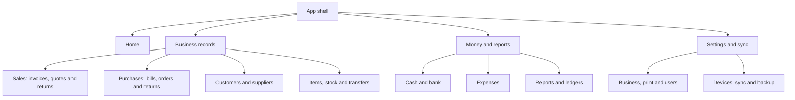
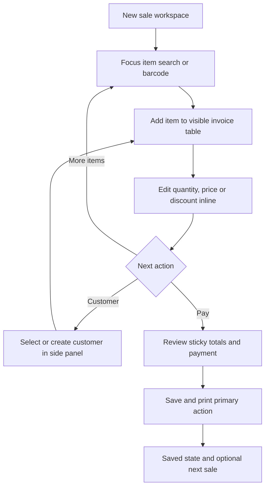

# UX and screen map

## Design direction

Use a calm, compact business UI with clear labels, familiar tables and a visible primary action. Prioritise completing work over decorative dashboards. Default to a light neutral canvas, dark readable text, a single blue action colour, and restrained status colours. All examples and fixture data must be labelled demo-only.

Primary desktop target is 1366 × 768 at normal zoom, plus 1920 × 1080 and 390 × 844 mobile. Use a collapsible roughly 216 px sidebar and a compact roughly 56 px header. Keep business/location selection, search, help, account and sync status in predictable places. Use responsive constraints rather than hard-coded pixel positions.

## Navigation and screens

| Area | Screens and actions | Behaviour |
| --- | --- | --- |
| Home | Today summary, receivables/payables, low stock, recent documents | Show data coverage; New Sale and Add Purchase are prominent |
| Sales | Invoices, New Sale, document details, quotations, credit notes | Filter/paginate server lists; preserve filters after opening detail |
| Purchases | Bills, Add Purchase, supplier returns, purchase orders | Stock and payable effects shown before posting |
| Parties | Customer/supplier list, details, statement, receive/pay | A party may be both customer and supplier; show balances separately |
| Items and Stock | Catalogue, categories/units, movements, counts, transfers | Quick create and archive; no destructive delete of referenced items |
| Cash and Bank | Accounts, transactions, receive/pay, transfer, cash close | Each account has its own book; transfers do not inflate revenue |
| Expenses | Category list, add/edit draft, expense detail | Dynamic categories, attachment state and clear payment account |
| Reports | Sales/purchases, party dues, stock/value, cash, P&L, trial balance, balance sheet | Same filters in view/export, source drill-down and provisional warnings |
| Settings | Business, tax profile, numbering, print, users and devices | Sensitive actions require scoped authority, not repeated password prompts for daily work |
| Sync and Backup | Queue, last sync, device state, review cases, export/restore | Plain language status with actionable recovery, no silent clearing |

### Navigation map

[Editable source](../diagrams/03-navigation.mmd)

## Billing workspace

Desktop: compact top strip for customer and date; item search/barcode input directly above a large editable cart; sticky totals and payment area at the right or bottom based on available width. The cart must show description, quantity/unit, rate, discount and line total without tiny text. Keep roughly half the usable desktop workspace for cart rows. Advanced tax fields and notes collapse by default. No large welcome banner above the bill.

Customer name/phone are optional for a walk-in cash sale. Require a party for credit sales and supplier bills. Do not require a restaurant code or irrelevant business-specific intake field. Select payment accounts in one control. Show total, paid amount, change and remaining due together.

Keyboard: searchable controls, Enter to add item, predictable Tab order, a documented save shortcut that does not conflict with browser behaviour, and Escape to close a non-destructive panel. Do not hijack keys while typing. Prevent double-submit while retaining the same command ID on uncertain outcomes.

Mobile: search at top, cart-first content, expandable customer details and a sticky total/checkout action. Use touch targets about 44 px, appropriate numeric keyboards and a payment bottom sheet. Avoid shrinking a desktop table into unreadable columns; use line-item cards or a compact list.

### Billing screen focus flow

[Editable source](../diagrams/22-billing-workspace.mmd)

## Visible transaction states

| State | User-facing text | Available action |
| --- | --- | --- |
| Draft | Draft — not issued | Edit or discard |
| Saved locally | Saved on this device — sync pending | Print, see queue |
| Uploading | Syncing… | Continue other work; prevent duplicate issue |
| Accepted | Synced | Print/share, eligible corrections |
| Retryable failure | Saved — retrying sync | Retry now, inspect connectivity |
| Held | Needs review — original bill preserved | View reason and authorised resolution |
| Read snapshot | Offline — saved data as of [time] | Browse; only supported writes offered |

Document lifecycle, payment status and sync status are separate badges. A paid bill may still be unsynced. A credited bill is retained, with links to its credit notes.

## Interaction rules

- Every important screen has loading, empty, error, permission-denied and offline states. Errors retain entered data.
- Use side panels for quick party/item creation without losing the sale. Offline new-item creation is a draft for later approval, so cached-item billing remains predictable.
- “Saved” appears only after storage commit. If storage is unavailable or quota exceeded, keep an unsaved warning and block issue/printing as a completed bill.
- Search/paginate large histories rather than loading all documents. Cache a defined permitted subset, not every business record.
- Provide accessible labels, visible focus, semantic tables, adequate contrast and reduced-motion support. Do not communicate status using colour alone.
- Confirm destructive drafts or financial reversals with a clear effect summary. Routine navigation and standard billing do not prompt for an admin password.
- Reprint uses the saved invoice snapshot and is visibly a reprint where configured. Editing the business logo or item name does not change historical receipt content unexpectedly.
- UI labels show business operations; internal cursor, database, queue hash and journal terminology belongs in authorised diagnostics, not normal cashier checkout.
