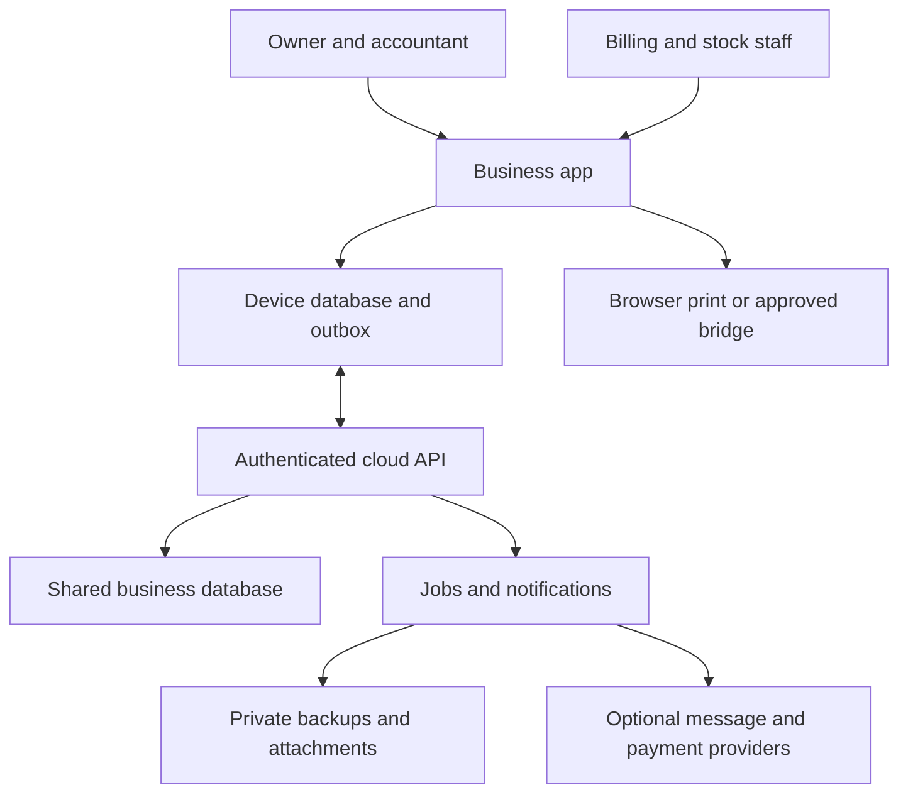
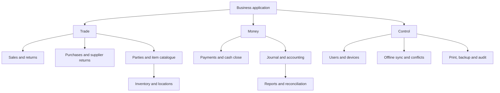

# Proposed architecture

## Chosen starting point

Use a TypeScript modular monolith with a responsive PWA and a cloud PostgreSQL authority. A single API deployment and a worker from the same codebase are enough initially. The stack is a proposal for this empty repository; pin supported versions during M01 instead of using unverified version numbers from this plan.

| Layer | Proposed technology | Reason |
| --- | --- | --- |
| Frontend | React + TypeScript + Vite | Familiar agent-supported UI and static deployment |
| Design | Tailwind CSS plus accessible reusable components | Consistent compact layout without a heavy dashboard theme |
| Forms/contracts | Zod and a form library; generated API types/OpenAPI | Shared input shape and explicit errors |
| Local persistence | Dexie over IndexedDB | Multi-store transactions for documents and durable outbox |
| Server | Node.js current supported LTS + Fastify + TypeScript | Structured API, schema validation, tests and plugins |
| Persistence | PostgreSQL + Prisma; reviewed SQL migrations where necessary | Relational constraints, row locks and accounting transactions |
| Domain math | Pure TypeScript package + exact decimal library | Same calculation rules online and offline |
| Jobs | PostgreSQL-backed transactional job/outbox worker | Keep notifications/exports independent of transaction latency |
| Tests | Unit/property tests, real PostgreSQL integration, Playwright | Verify money, isolation, concurrency and browser persistence |
| Workspace | pnpm workspaces and one lockfile | Shared domain/contracts without service sprawl |

Supabase or another managed PostgreSQL provider can host the database later. Do not couple domain logic to a particular hosting dashboard, bypass the API from the client, or create an unnecessary second source of auth authority.

### System context

[Editable source](../diagrams/01-system-context.mmd)
### Module ownership

[Editable source](../diagrams/02-module-map.mmd)

## Intended source layout

| Path | Responsibility |
| --- | --- |
| apps/web | Routes, screens, local database, outbox runner, PWA and print UI |
| apps/api | Auth, business scope, command handlers, reports and OpenAPI |
| apps/worker | Transactional jobs, export/backup processing and optional notifications |
| packages/domain | Exact calculations, posting rules, transitions and pure fixtures |
| packages/contracts | Versioned commands, DTOs, error codes and schemas |
| packages/db | Schema, reviewed migrations, repository helpers and tenant transaction wrapper |
| packages/ui | Accessible shared components and design tokens |
| tests/integration | Real DB isolation, posting, concurrency and migration scenarios |
| tests/e2e | Browser, offline/reload, two-context sync and responsive journeys |
| docs | Planning, decisions, operations and evidence |

Create only what the current milestone needs. Empty placeholder services do not count as implementation.

## Module boundaries

Identity owns users, sessions, memberships and device enrolments. Catalogue owns items, units and parties. Trade owns sales/purchases/credits. Inventory owns quantity/value movements and cost adjustments. Accounting owns journals, allocations, periods and reporting projections. Sync owns command receipts, change batches and review cases. Operations owns backup, import, attachments and print settings.

Trade calls domain posting functions and persists effects in one database transaction; accounting and inventory must not independently post again from an asynchronous event. The async outbox is for secondary work, such as file exports or notifications. Rebuilding a report projection must not create new financial effects.

## Command and transaction boundary

Every mutation uses a stable command ID and common validation pipeline, including online actions. In one short transaction: authenticate scope, lock business sync-head, check idempotency/hash, lock affected records in deterministic order, validate current state, write source document/event, balanced journal and stock effects, audit, command receipt and change batch, then advance sync-head. Return only after commit. Do not wait for a printer, provider, file upload or user interaction in that transaction.

The business sync-head serialises commit-visible cursors for a small-business workload. A plain sequence can be allocated before an earlier transaction commits and cause a pull client to skip data permanently. All writers, including cost adjustments/imports, must obey this lock. Revisit this bottleneck only with measured load and a proven alternative.

Use database unique constraints for effect identity and document numbers. Retry transient deadlocks/serialisation failures with bounded backoff and the same command ID. Last-write-wins is not a financial conflict policy.

## API families

| Family | Examples and responsibility |
| --- | --- |
| Identity | /v1/auth/*, /v1/businesses, /v1/memberships, /v1/devices |
| Queries | /v1/items, /v1/parties, /v1/documents, /v1/accounts with validated scope and pagination |
| Commands | /v1/commands or typed routes invoking the same command dispatcher |
| Sync | /v1/sync/bootstrap, /push, /pull, /status and review-case actions |
| Reporting | /v1/reports/* and export jobs with identical filter semantics |
| Operations | /v1/backups, /v1/imports, /v1/attachments using scoped signed downloads |

Tenant/business in a request is a selection, not evidence of access. Resolve it through membership and device scope. Financial reports use accepted server data; the UI may show a separately labelled local preview.

## Platform decisions

The PWA is the first delivery vehicle. Service workers cache versioned app assets; IndexedDB stores permitted business data. Background Sync is optional: app startup, reconnect, foreground timer and manual retry must suffice. Browser data can be evicted or explicitly deleted; request persistence and provide recovery bundles without promising permanent browser storage.

No Electron/SQLite or Android fork in the core build. If physical printing, local durability or OS integration fails the pilot requirements, record evidence and introduce a thin native shell with the same domain/command protocol in a later milestone. A second implementation of business calculations is not acceptable.
