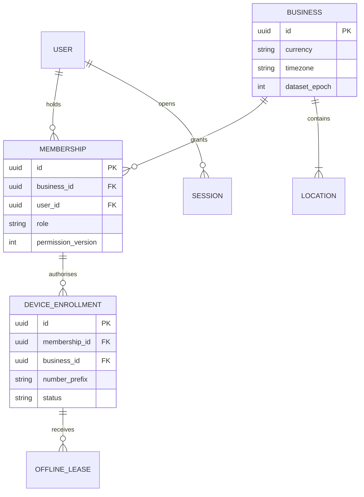
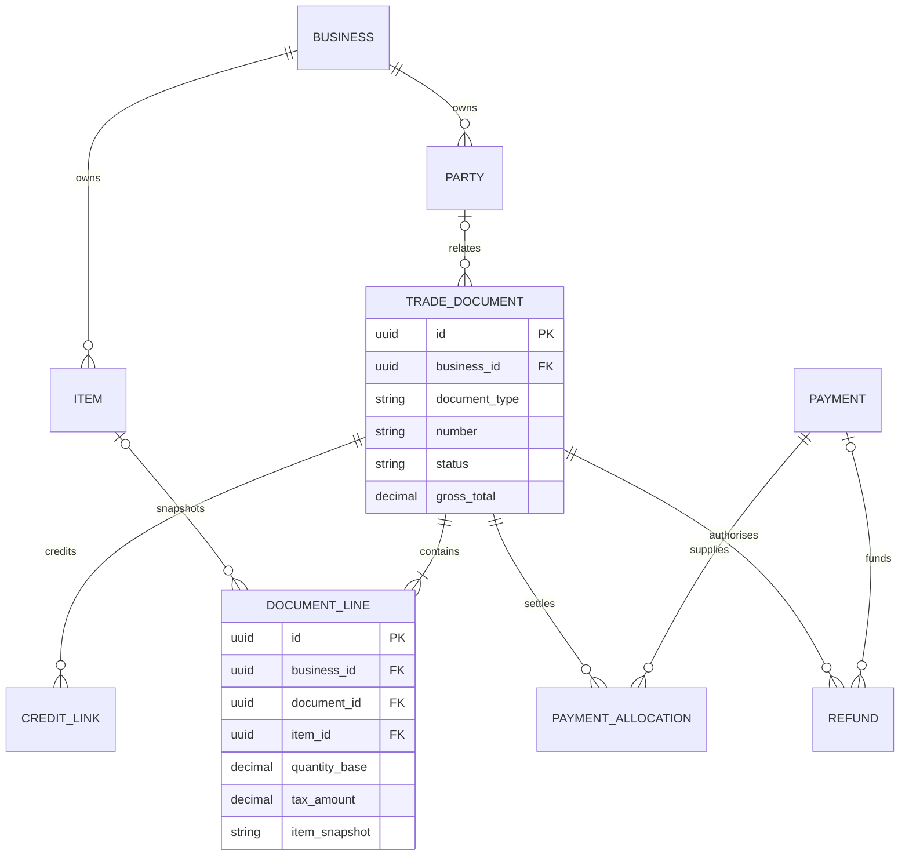
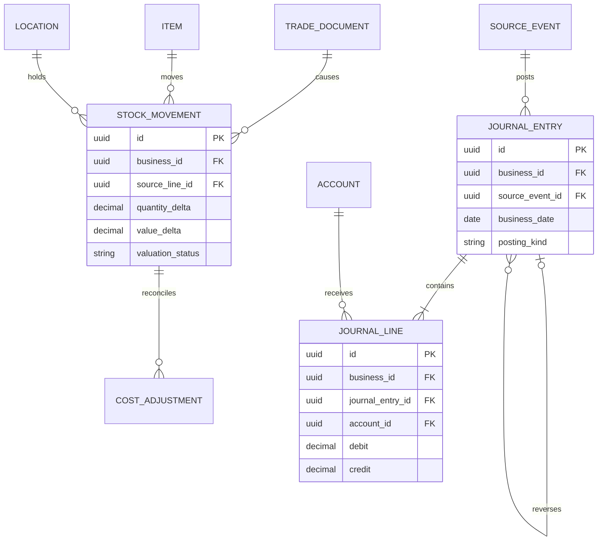
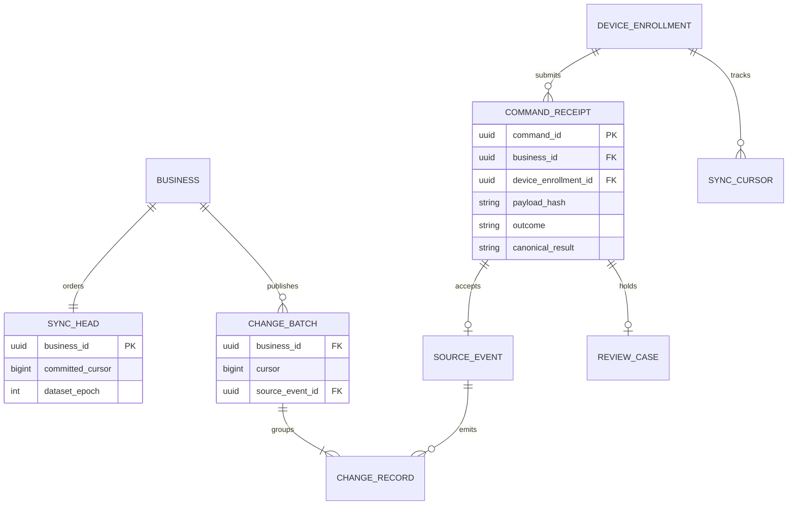

# Conceptual data model

These are domain entities and required constraints, not a ready-made Prisma schema. M02–M08 turn them into reviewed migrations. Use UUID identifiers, stable client-generated IDs for supported offline records, and explicit business ownership everywhere.

### Identity and business entities

[Editable source](../diagrams/18-erd-identity.mmd)
### Trading documents and payments

[Editable source](../diagrams/19-erd-trade.mmd)
### Accounting and stock lineage

[Editable source](../diagrams/20-erd-ledger-stock.mmd)
### Sync records and effect uniqueness

[Editable source](../diagrams/21-erd-sync.mmd)

## Entity groups

| Group | Entities and required facts |
| --- | --- |
| Identity | User; Session; Business; Membership with role/scopes; DeviceEnrollment with status/prefix; OfflineLease with signed scope/policy/expiry |
| Catalogue | Party with customer/supplier flags; Item or service; Category; Unit; ItemUnitConversion; TaxProfileVersion; Location; optional later PriceList |
| Trade | TradeDocument with typed sale/purchase/credit/quote/order; DocumentLine snapshots; CreditLink to original line; version/status/due date; internal number and external supplier reference |
| Money | Account; Payment; PaymentAllocation; Refund; AccountTransfer; Expense; ExpenseCategory; CashSession and immutable Close/LateAdjustment |
| Inventory | StockMovement; StockBalance projection; InventoryCostState; CostAdjustment/Deficit; StockCount; Transfer and TransferLine; source/destination/transit location |
| Accounting | SourceEvent; JournalEntry; JournalLine; FiscalPeriod; OpeningBatch; derived balances and report snapshots |
| Sync | SyncHead; CommandReceipt; ChangeBatch/ChangeRecord; SyncCursor; ReviewCase; immutable number registry |
| Operations | AuditEvent; Attachment; JobOutbox; BackupManifest; RestoreSession; ImportBatch/ImportRowResult |

## Field and relationship rules

- Every business entity has business_id. Cross-record references use composite foreign keys such as (business_id, item_id) -> Item(business_id, id), with matching unique indexes. A globally unique UUID alone does not prove same-business ownership.
- Location-scoped records carry location_id; access checks apply permitted locations as well as business membership. A device may only issue into its enrolled location/numbering policy.
- Record business_date, created_at, accepted_at and source_device_id separately. Client clocks are untrusted; server acceptance and committed cursor determine ingest order.
- Trade documents separate lifecycle, payment and sync states. Payment status is derived from accepted allocations/credits, not an independently editable paid flag.
- Lines snapshot item label/SKU, unit conversion, price, discount, tax rule/version and amounts. Retire/archive referenced catalogue rows; never cascade-delete posted lines.
- Store money at currency precision (initially 2 decimals), quantities at 6 decimals and average costs at at least 8 decimals, with numeric ranges justified in M03. Send decimals as strings over JSON. Do not serialise monetary decimal strings through Number.
- Journals use separate nonnegative debit/credit amounts; each line has exactly one positive side. The complete entry balances, enforced by the posting service plus a deferred database check/constraint trigger or equivalent commit-time guard. Do not enforce balancing with an individual-row CHECK that cannot see the whole entry.
- Balance and stock summary tables are projections with source lineage and rebuild procedures. They are not independent editable truth.

## Required uniqueness and indexes

| Constraint | Prevents |
| --- | --- |
| Membership(user_id, business_id) | Duplicate identity within a business |
| Device prefix unique within business; prefix never reused | Offline document-number collision across installations |
| Document(business_id, document_type, number) | Duplicate displayed document identity |
| CommandReceipt(business_id, dataset_epoch, command_id) plus immutable payload_hash | Repeated delivery creating new effects or changing payload |
| SourceEvent(business_id, command_id, effect_kind) | Duplicate business posting |
| JournalEntry(business_id, source_event_id, posting_kind) | Duplicate journal from a retried source event |
| StockMovement(business_id, source_event_id, source_line_id, movement_kind, leg) | Duplicate stock effect, including transfer legs |
| PaymentAllocation(business_id, command_id, allocation_key) | Double settlement after timeout |
| ChangeBatch(business_id, dataset_epoch, cursor) | Ambiguous sync continuation |
| Supplier reference within business/supplier/document kind when present | Accidental duplicate supplier bill; permitted exception must be explicit |
| Item barcode within business when present | Ambiguous scan target |

Index documents by business/date/id and business/party/date; stock by business/location/item; journal lines by business/account/date; command receipts by business/command; change feed by business/epoch/cursor. Validate report query plans with realistic fixtures before claiming scale.

## Local database

Partition each local database by user + business + enrolment + dataset epoch. Stores include permitted catalogue/parties, document snapshots, local counters, drafts, outbox, command acknowledgements, pull cursor, conflicts/review metadata, signed lease and report snapshots. Server-only secrets, password hashes and unauthorised cost/profit fields must never be replicated.

Apply each change batch and its cursor in one local transaction. Maintain canonical and pending overlays separately so an incoming snapshot cannot erase locally issued work. Enforce one local number allocation transaction across browser tabs; a best-effort tab leader improves traffic but server idempotency remains mandatory.

## Revision and deletion policy

Editable master data uses an expected integer version. Draft documents may be replaced with version checks. Posted financial records are immutable except derived/status projections updated by linked events. Tombstones describe archived/deleted editable records for sync. Never cascade financial history through party/item/account removal. Retain number/idempotency registries across backups and restores; archival cannot permit reuse.
