# Business flow diagrams

The diagrams describe intended behaviour. They are not evidence of running features. Architecture, entity, sync, security and roadmap diagrams live in the linked specifications; [the catalogue](../diagrams/README.md) lists all 30 sources.

## Set up the business

### Business and device onboarding

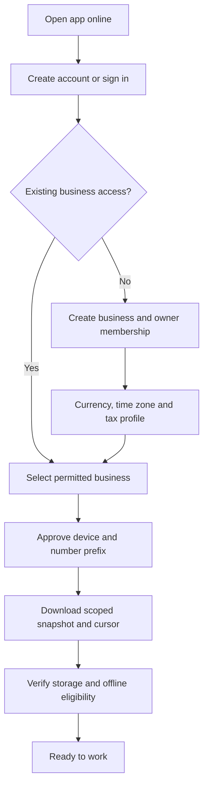

[Editable source](../diagrams/04-onboarding.mmd)

Online enrolment establishes identity, device numbering and a scoped initial snapshot. Opening balances are entered through a balanced setup workflow, not arbitrary edits to cash or stock totals.

## Sell and collect

### Online sale posting

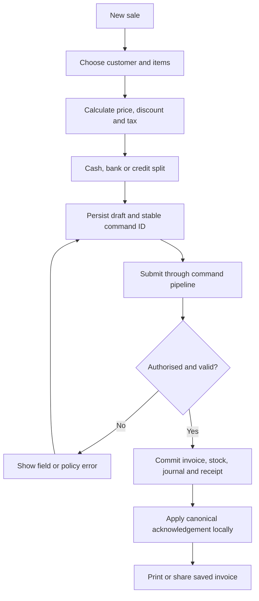

[Editable source](../diagrams/05-sale-online.mmd)
### Offline sale and later reconciliation

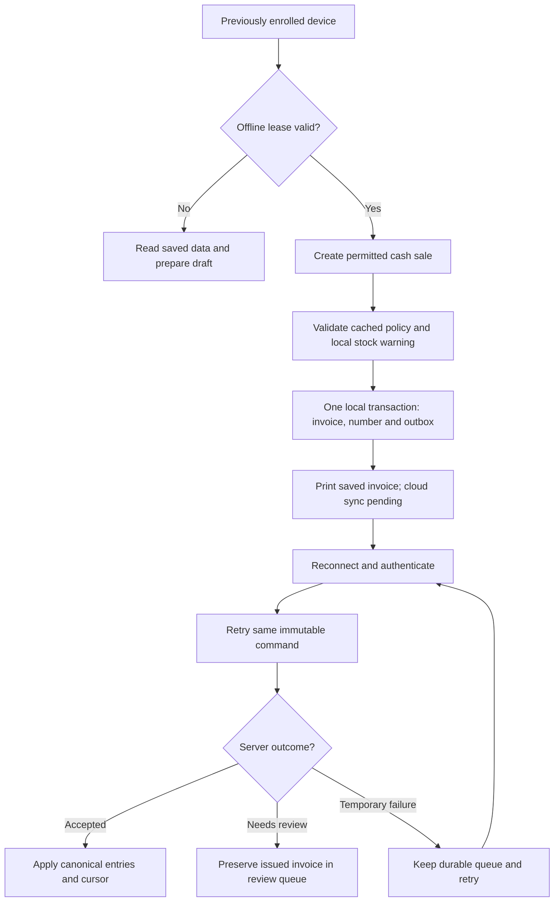

[Editable source](../diagrams/06-sale-offline.mmd)
### Business document lifecycle

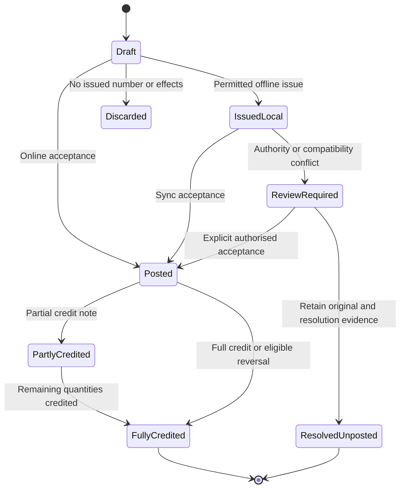

[Editable source](../diagrams/25-document-state.mmd)

Walk-in cash sales need no customer record. Credit sales require a party and current online credit-policy checks in the first release. A receipt always comes from saved data. Payment status is separate from document and sync status.

## Correct a sale

### Return and refund

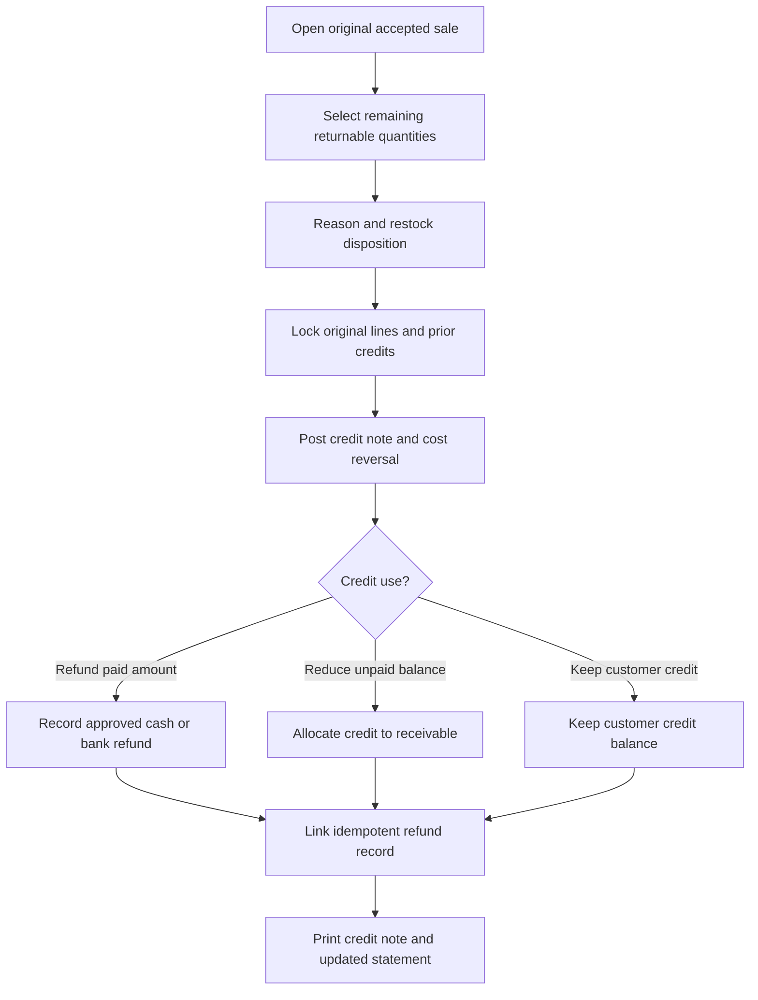

[Editable source](../diagrams/10-return-refund.mmd)

No delete-and-recalculate shortcut is allowed for a posted sale. A credit note can reduce an unpaid balance, retain customer credit or support an actual refund, subject to remaining quantities and amounts. A refund is a separate money event; it must not reverse revenue a second time.

## Buy, pay and record expenses

### Purchase and supplier payable

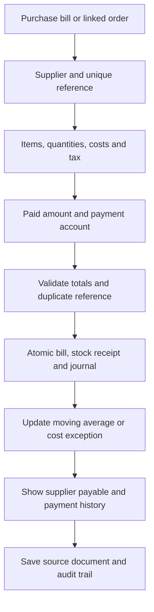

[Editable source](../diagrams/11-purchase.mmd)
### Payments and invoice allocation

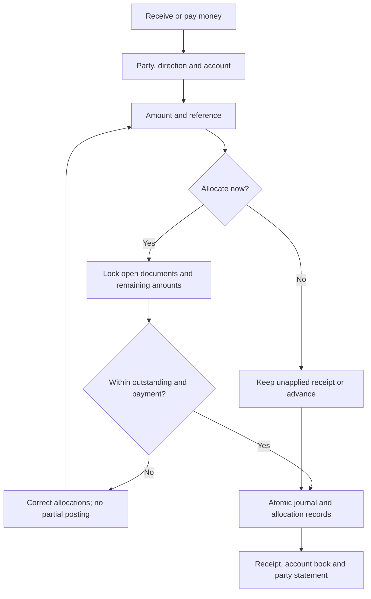

[Editable source](../diagrams/12-payment-allocation.mmd)
### Expenses and account transfers

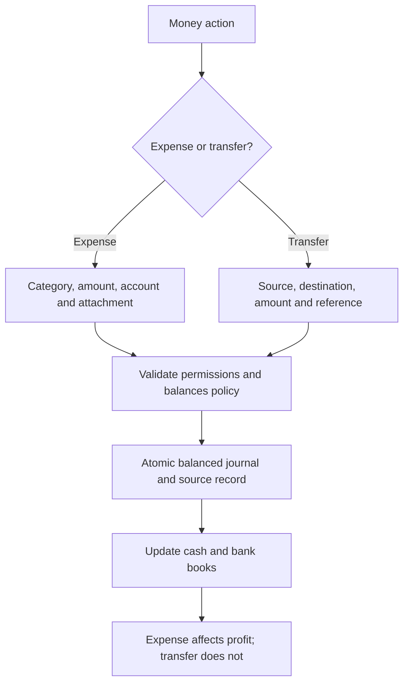

[Editable source](../diagrams/13-expense-transfer.mmd)

Purchase receiving and its accounting effect are atomic for the core purchase bill. Separately receiving against a purchase order belongs to M12 and must not double-add stock when a bill is later linked. An expense reduces profit; a cash-to-bank transfer does not.

## Control stock and daily cash

### Warehouse transfer with stock in transit

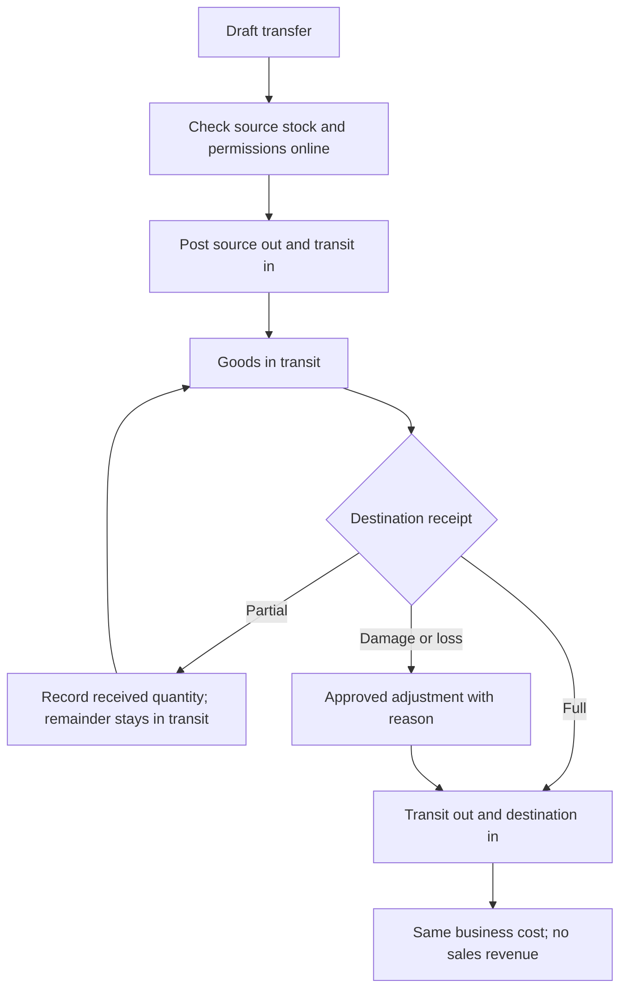

[Editable source](../diagrams/14-stock-transfer.mmd)
### Negative stock valuation

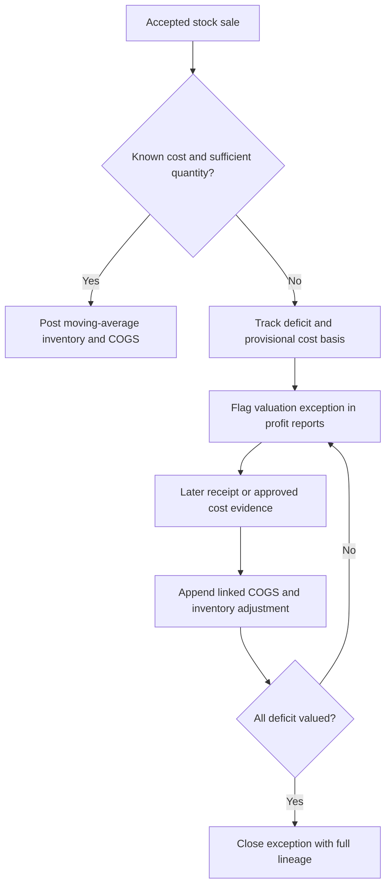

[Editable source](../diagrams/27-valuation-exception.mmd)
### Cash-session reconciliation

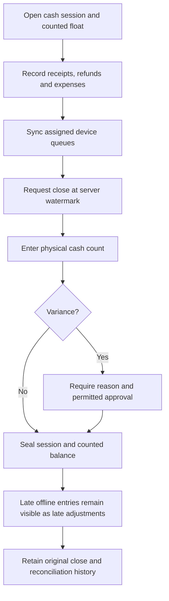

[Editable source](../diagrams/26-cash-close.mmd)

Warehouses in the extended release use transit stock between dispatch and receipt. Negative stock caused by disconnected sales remains visible with provisional valuation; later cost evidence creates linked adjustment entries. Cash close preserves its original watermark and count when late offline records arrive.

## Review, protect and extend

### Report freshness and authority

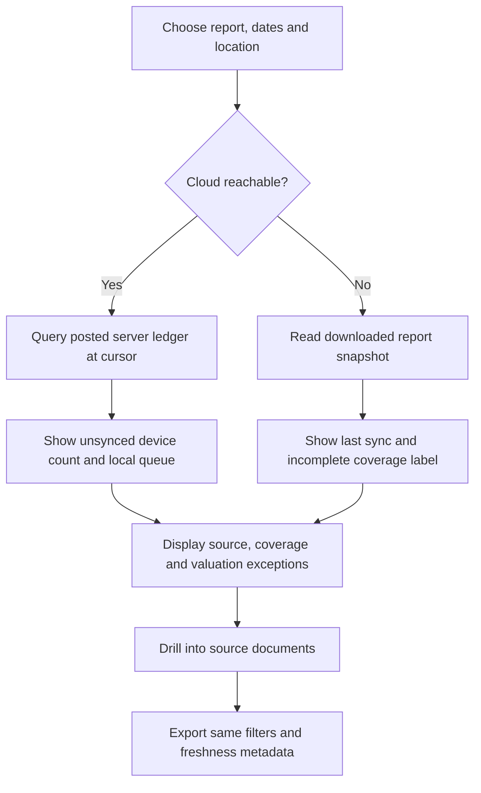

[Editable source](../diagrams/15-reports.mmd)
### Backup and isolated restore

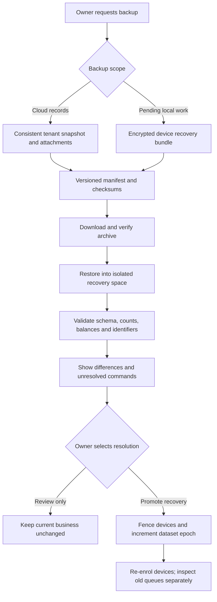

[Editable source](../diagrams/16-backup-restore.mmd)
### Safe data import

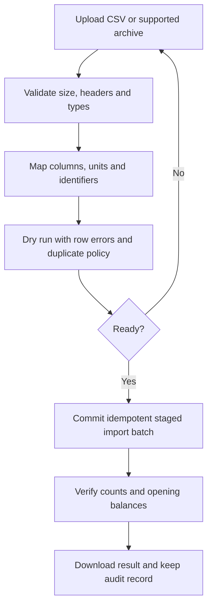

[Editable source](../diagrams/29-data-import.mmd)
### Quotes, orders and conversion

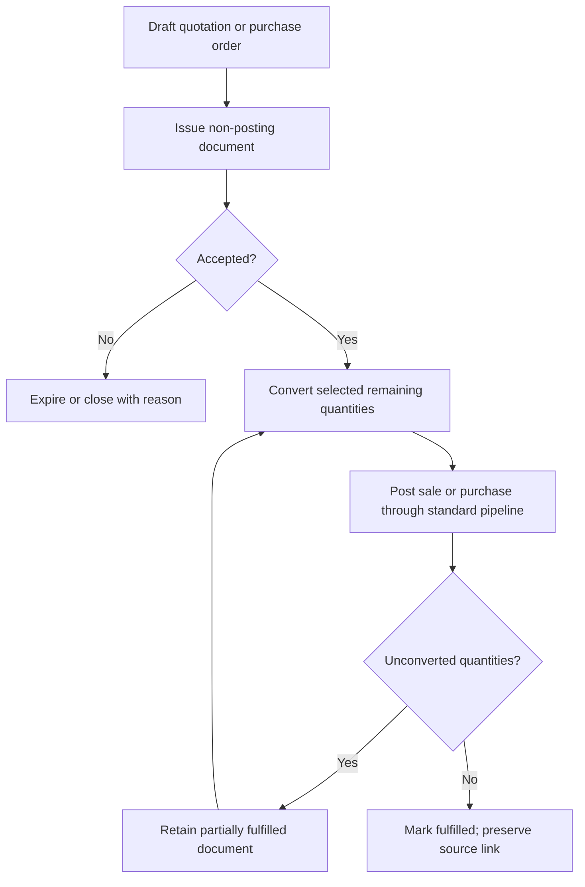

[Editable source](../diagrams/28-quotes-and-orders.mmd)

Reports and exports carry the same filters and freshness information. A backup restore is first validated in isolation. An issued quote or order has no revenue/stock journal until a posting action explicitly converts or fulfils it.

## Other diagram groups

| Topic | Rendered diagrams |
| --- | --- |
| System and modules | [Architecture](04-architecture.md) |
| Screen navigation and billing focus | [UX map](03-ux-and-screen-map.md) |
| Entities and relationships | [Data model](05-data-model.md) |
| Delivery retries and conflicts | [Offline sync](07-offline-sync.md) |
| Offline authority and revocation | [Security](09-security-permissions.md) |
| Milestone dependencies | [Roadmap](10-delivery-roadmap.md) |
| Production runtime | [Deployment](12-deployment-backup.md) |
