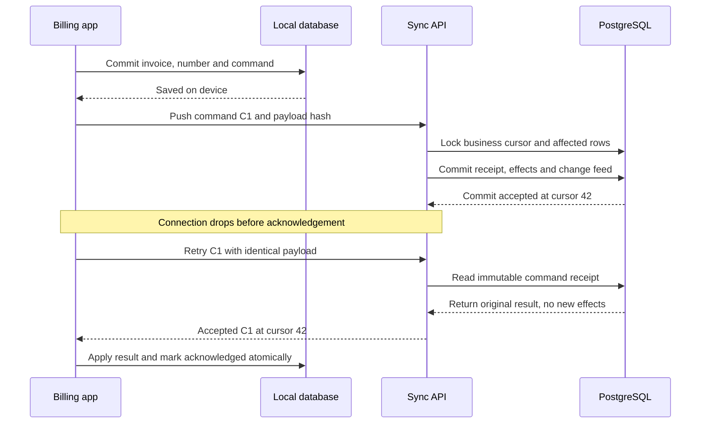
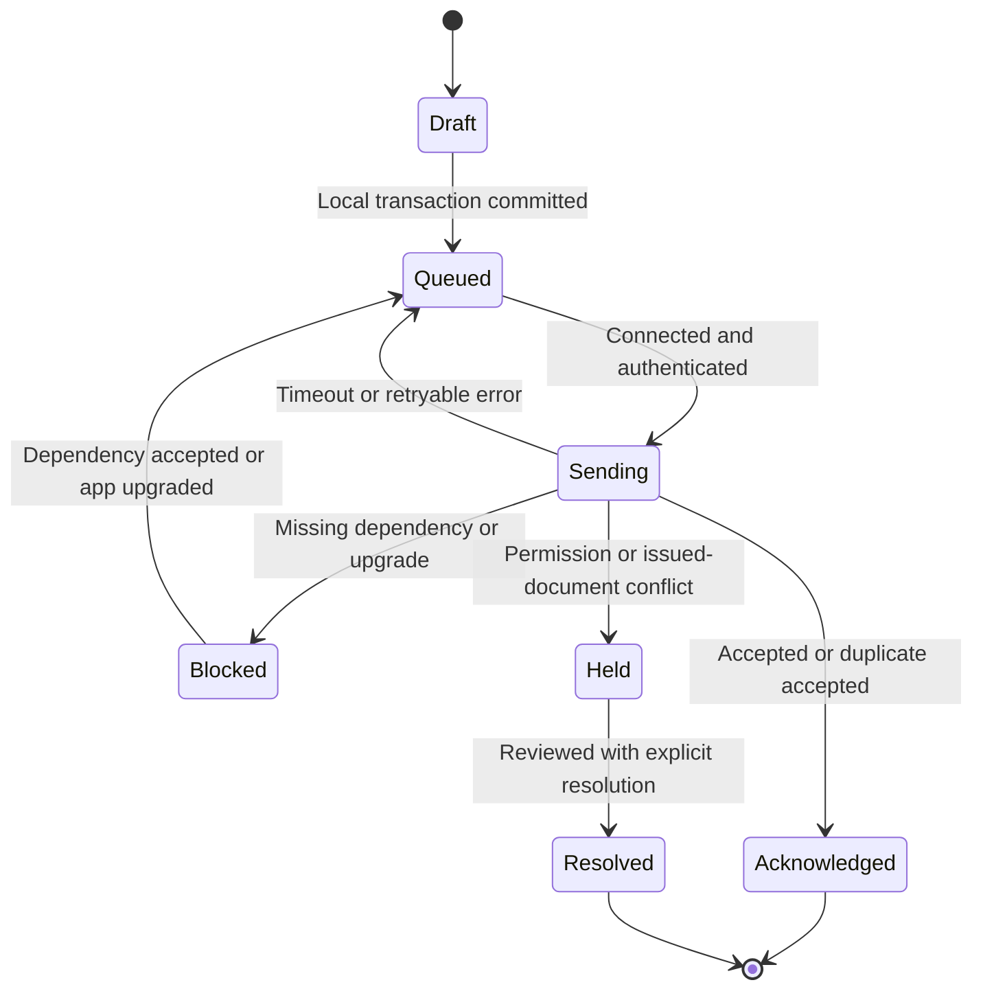
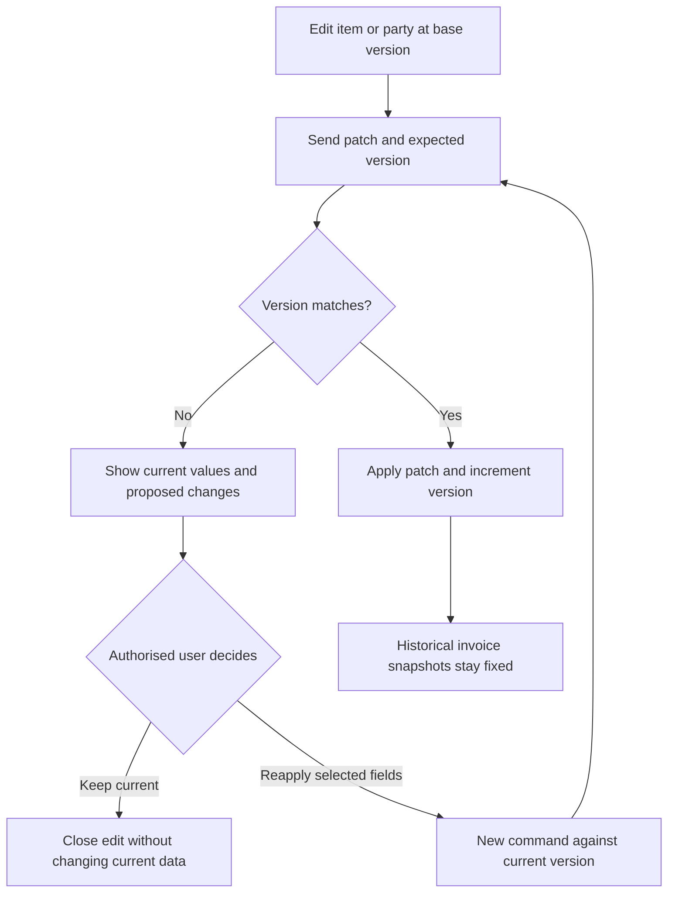

# Offline and multi-device protocol

> Historical specification: the product switched to online-only web delivery on 2026-10-20. No new offline issue or command upload is supported. This document explains prior implementation and the legacy records that must be preserved for authorised reconciliation. Follow the [current roadmap](10-delivery-roadmap.md) for new work.

## Guarantees and limits

Use a local database as the device's working store and PostgreSQL as the authority for accepted shared records. Support at-least-once command delivery with exactly-once business effects enforced by transaction boundaries and unique keys. Do not claim exactly-once network delivery.

A disconnected device cannot see another device's new work, immediately honour remote revocation, guarantee company-wide stock availability or enforce a shared credit limit. The product explicitly accepts those limits: bounded signed offline leases, a documented actions matrix, stock warnings/provisional costs, and online-only scarce-resource/credit/refund actions.

Browser persistence is not a permanent backup. Storage pressure, user clearing data, device loss or power failure can lose data that has never reached another system. Request persistent storage, monitor quota, provide encrypted recovery export, and select a native shell later if measured durability/hardware requirements demand it.

## Initial bootstrap

1. Authenticate online; resolve membership, permitted locations and device enrolment.
2. Allocate a non-reusable server-issued device prefix, dataset epoch and signed offline lease. Proposed lease is 72 hours; it is a product decision in the risk register, not a legal guarantee.
3. Build a consistent permission-filtered snapshot at committed cursor C. A snapshot token binds business, enrolment, epoch, permission version, schema version and scope. Chunk downloads use the same snapshot generation, not changing live queries.
4. Store chunks into a staging local store, verify manifest/counts, then switch active snapshot and cursor atomically. Continue issuing only after required catalogue/policy data is present.
5. Pull all changes after C. Tombstones and versioning make the local view converge. A permission change invalidates the old scope and forces a new restricted snapshot.

## Stable command envelope

```json
{
  "commandId": "client-generated-uuid",
  "businessId": "selected-business-uuid",
  "datasetEpoch": 1,
  "deviceEnrollmentId": "server-issued-enrolment-uuid",
  "schemaVersion": 1,
  "calculationVersion": 1,
  "policyVersion": 1,
  "type": "sale.issue",
  "aggregateId": "stable-document-uuid",
  "expectedVersion": null,
  "dependencies": [],
  "occurredAt": "2026-10-15T10:00:00Z",
  "businessDate": "2026-10-15",
  "offlineLeaseId": "signed-lease-reference-if-offline",
  "payloadHash": "hash-of-canonical-command-content",
  "payload": {"documentNumber": "S-L01-D01-2026-000001", "amountsAreDecimalStrings": true}
}
```

The example is a shape illustration, not a complete sale payload. The server recomputes the canonical payload hash; client hashes are not trusted. Bind the full command type, scope, versions and payload; exclude transport attempt timestamps/signatures that legitimately change. Same command ID plus different content is a conflict with no new effects. Retries never allocate a new document ID or number.

## Local write transaction

For an allowed offline issue, validate cached policy/lease, calculate a frozen document snapshot, then atomically increment local counter, store the issued document, record provisional local effects and enqueue the immutable command/dependencies. No network/cryptographic wait inside the IndexedDB transaction; precompute necessary material. Display saved/print only after transaction completion. Handle abort, quota error and process restart. Do not rely on unload handlers to save business records.

Document number proposal: type + location code + never-reused device prefix + year + monotonic counter. The UUID remains canonical identity. Do not renumber accepted offline invoices. Numbers need not be gapless and are not a tax-regulated numbering promise. On restored/cloned devices create a new enrolment/prefix; never reset an existing prefix counter.

## Server push

1. Validate authenticated business, device status, epoch, command schema/size and action authority. Reject unauthorised reads; retain a narrowly scoped issued-record recovery intake where authorised ownership review is possible.
2. In a transaction lock the business sync-head first. Read any existing receipt for the command ID and compare hash. For a duplicate return the original canonical result without posting again.
3. Resolve dependencies and lock affected stock/cost state, document lines, accounts or allocations in deterministic order. Verify reference ownership and rule versions. Recalculate amounts from frozen price/tax snapshots under the supported calculation version; do not silently replace a sold price with today's catalogue price.
4. Validate state and perform one atomic posting. Persist receipt/result, source event, document, journal, stock, audit, related jobs and a complete change batch at C+1. Advance sync-head in the same transaction.
5. Commit, then acknowledge. Process a batch with explicit per-command results. A failed dependent command must not prevent independent valid commands from being retried or accepted. Dependency cycles are validation errors.

Unknown schema, dependency missing, revoked authority, closed accounting period and altered payload have distinct machine codes and user actions. Never discard an issued local bill because the upload is rejected. Financial validation errors are not converted into success to clear a queue.

### Acknowledgement loss and duplicate delivery



[Editable source](../diagrams/07-sync-sequence.mmd)
### Command delivery states



[Editable source](../diagrams/08-sync-state.mmd)

## Pull and cursor correctness

Use monotonically increasing, commit-ordered cursors per business and dataset epoch. The business sync-head lock is acquired by **every** writer before changing replicated state, so later cursors cannot commit ahead of earlier ones. An ordinary SQL sequence or wall clock is insufficient.

A change batch contains all view-safe changes from one committed event. Return complete batches and a signed continuation cursor; do not split an atomic batch across an untracked cursor. If a batch is large, use a manifest/chunk protocol with an atomic local apply point. Apply batch data plus cursor in one local transaction. Lost responses can be fetched again safely.

Filter both rows and fields by membership/location; avoid sending costs/profits to cashiers. A filtered page still advances through scanned batches without disclosing hidden payloads. Bind cursor to scope/permission version. SSE/WebSocket messages are only hints to pull; dropped hints cannot lose data because periodic/foreground pull resumes from the durable cursor.

Retain a documented change-feed window (proposed 90 days) and durable idempotency/number registries for the financial retention period. If a cursor expires, pause upload, export/preserve pending overlays, fetch a new snapshot, then reconcile compatible commands. Do not erase pending work or allow reused command IDs after feed pruning.

## Retry and concurrency

Run sync on app startup, foreground reconnect, periodic foreground timer and manual retry. Use exponential backoff with jitter, bounded requests, and distinct handling for 401/re-auth, 403/revocation, 409/conflict, 429/rate limit and 5xx/transport failures. Background Sync is an optional browser enhancement, not a dependency.

Use a local lease/tab leader to reduce duplicate sending; it is not the correctness boundary. Two tabs racing issue must share a single counter/outbox transaction. Multiple devices use different prefixes. Two different command IDs describe different transactions unless a documented external-reference constraint detects a real duplicate.

### Concurrent master-data edits



[Editable source](../diagrams/09-metadata-conflict.mmd)

## Conflict and exception policy

| Conflict | Rule |
| --- | --- |
| Item/party changed | Expected-version conflict; show current and proposed fields; reapply selected changes as a new command |
| Cached item archived or price changed | Retain historical snapshot if permitted by lease/rule version; do not silently reprice; unsupported policy enters review |
| Same invoice retried | Return original receipt; no new journal, payment or stock movement |
| Two devices sell last item | Preserve both allowed sales; negative quantity and valuation exception; do not pretend strict availability |
| Strict-stock business | Disable offline issuing; draft remains possible; reservation/quota design is future work |
| Credit/refund race | Posting online only; lock remaining shared limits and reject excess atomically |
| New party duplicates another | Keep stable IDs and suggest later merge; merging preserves history and is an audited online action |
| Revoked device or membership | Lock on reconnect; hold pending issued records for owner review; never silently post under revoked authority |
| Closed period/backdated local bill | Preserve original, review and post approved adjustment in an open period; do not rewrite a closed period |
| Restored business / epoch mismatch | Fence upload and old sessions; isolated review of old pending commands; no automatic replay |
| Unsupported calculation/schema | Preserve queue, update compatible app, retry or reviewed migration; never recalculate old receipts in place |

An authorised resolution is a new immutable decision linked to the original command. Acceptance posts the original business effect once; rejection retains evidence and any real-world cash/stock correction must be represented explicitly. Do not delete evidence or issue a second sale accidentally.

## Logout, upgrade and recovery

Lock local data immediately on logout. If pending issued records exist, online sync or an encrypted recovery bundle must precede intentional purge; never present an unconditional “clear cache” fix. A forced security lock may keep an inaccessible encrypted recovery record for owner handling. Browser profiles are trusted-device boundaries, not secure isolation against an OS administrator or active XSS.

Use additive local migrations and queued-command schema versioning. Do not auto-activate a service worker while a bill is being issued; negotiate update at a safe point, test interrupted migration, and retain a recoverable previous local store until validation. No mutation may proceed if the app cannot guarantee storage availability or supported schema.

## M06 non-negotiable proof

Two independent browser contexts with one business; cached sign-in; offline cash sale; ordinary close/reopen; simultaneous last-item sales; dropped acknowledgement; repeated push; two-tab number race; storage quota failure; stale item version; revoked device; expired lease; pull page interruption; permission-filtered resnapshot; epoch mismatch. Both clients converge after reconnect without duplicate effects or lost queued records. Test server-commit cursor ordering by deliberately delaying a transaction, not just by checking increasing numbers.
