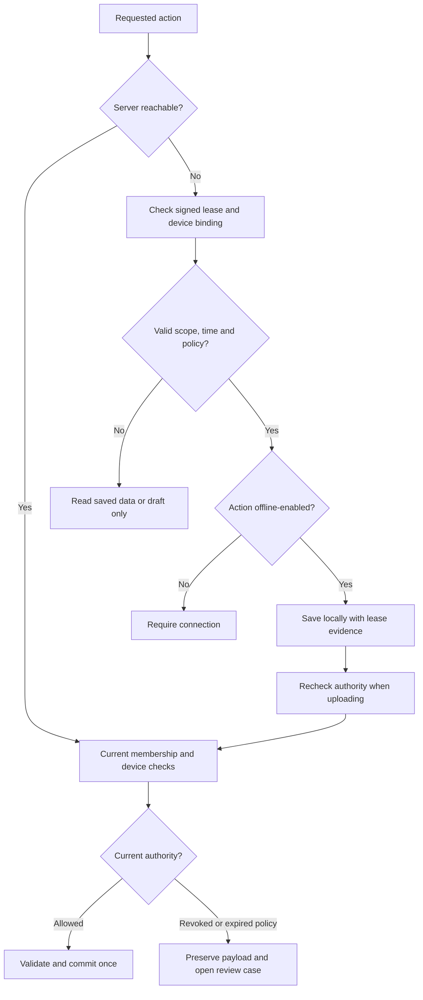
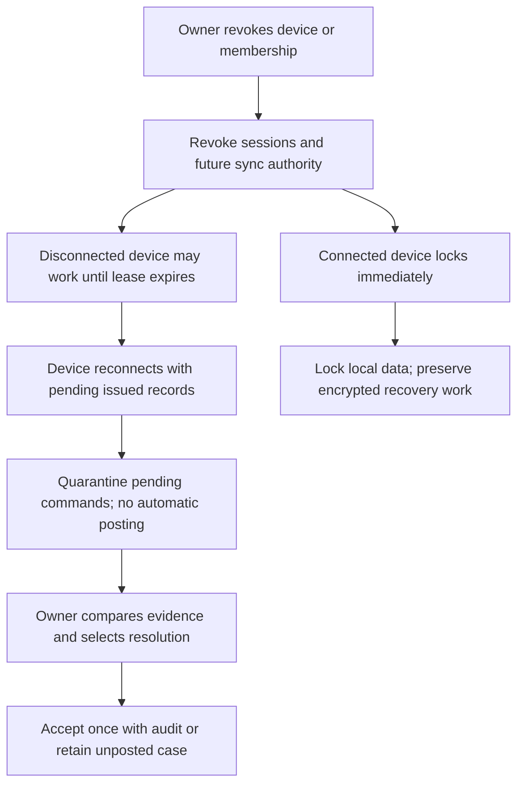

# Security, permissions and devices

## Tenant and location boundary

Every business request resolves an authenticated membership, permitted locations and device status. Never trust business_id, location_id or a path UUID alone. Apply the same boundary to queries, mutations, sync feed, reports, exports, jobs, attachments, backup/restore and diagnostics.

Use tenant-consistent composite foreign keys and a restricted database runtime role. Add and test PostgreSQL RLS as defence in depth: runtime role is neither table owner nor BYPASSRLS, relevant tables use FORCE ROW LEVEL SECURITY where appropriate, and SET LOCAL tenant context lives only inside a scoped transaction. Test pooled connection reuse so context cannot leak. Maintenance/backup roles are separate, narrowly authorised and audited.

## Proposed role presets

| Capability | Owner | Accountant | Cashier | Stock manager | Viewer |
| --- | --- | --- | --- | --- | --- |
| Business/users/devices | Full | No | No | No | No |
| Sales and ordinary receipts | Full | Yes | Scoped | No by default | Read if granted |
| Purchases/expenses/payments | Full | Yes | No by default | Receive stock if granted | Read if granted |
| Returns/refunds | Full | Yes within policy | Request only | No | No |
| Catalogue/stock | Full | Yes | Read sellable data | Scoped manage | Read if granted |
| Cost/profit/accounting | Full | Yes | No | Stock cost only if granted | Explicit report grants |
| Backup/export financial data | Full | Explicit grant | No | No | No |
| Promote restore/period lock | Full | Request or explicit scoped grant | No | No | No |

“Scoped” includes business, location, permitted accounts and action limits. Recheck sensitive actions at server commit. Owner and commercial platform administrator are different identities/scopes; an eventual platform admin does not silently gain a business's full transaction data.

## Authentication

Use global unique username plus password (email optional recovery attribute), with business selection after login. Do not require a hidden restaurant code or an email field when the UI accepts username. Normalise identifiers consistently and rate-limit by account and source without counting successful sign-ins as failures. Use a maintained password-hash library and supported parameters measured at implementation time; no default production password or demo login.

Prefer same-origin server sessions in Secure, HttpOnly, SameSite cookies, session rotation, revocation, CSRF protection where needed and no-store auth responses. Do not cache session cookies/passwords in IndexedDB or localStorage. Password changes verify current credentials, revoke other sessions as configured and create a redacted audit event. Recovery tokens are single-use, hashed, expiring and not echoed in logs. Without an actual recovery provider, show an honest configured owner-support route rather than fake “email sent” success.

Daily billing should not repeatedly ask for an admin password. Use the logged-in role. Re-authentication is justified for credential changes, owner transfer, restore promotion or other defined sensitive operations. MFA for owners is a proposed extension; a commercial platform must define and test its stronger administrator authentication before launch.

## Offline authority

Offline use requires prior online enrolment, an explicit device approval and signed bounded lease. Proposed default: 72-hour issue window, restricted actions/locations/accounts, policy/calculation versions and membership version. Local unlock uses a device-local credential/key design; never store or reuse the server password for offline verification. Rate-limit unlock attempts and minimise retained fields. Do not claim a browser PIN encrypts against an OS administrator or protects against active XSS.

Validate signature, business/device binding, expiry and clock anomalies before offline issue. A clock rollback or incompatible version pauses new issue and requires online refresh. Browser-side lease checks are operational controls on a trusted device, not tamper-proof hardware enforcement. On upload, current server authority remains decisive; a signed lease is not proof that a client timestamp is honest.

### Offline lease and online authority

[Editable source](../diagrams/23-offline-authorisation.mmd)
### Device revocation and pending work

[Editable source](../diagrams/30-revocation.mmd)

Connected devices receive revocation quickly through session invalidation and pull hints. A disconnected device may continue locally until its lease check stops it; remote deletion cannot be guaranteed while disconnected. On reconnect, lock and quarantine unaccepted records. Owner review either accepts one original effect or retains an unposted case with explicit business resolution.

## Local confidentiality and lifecycle

- Partition stores by user/business/enrolment/epoch. New users cannot open another user's pending records. Request only the rows/fields they are permitted to retain.
- A cashier snapshot excludes cost, profit, bank balances and private reports unless separately granted. Client-side hidden columns are insufficient.
- Encrypt sensitive recovery bundles using a reviewed authenticated format, a user-held recovery secret or approved managed key, and documented recovery UX. Do not invent custom cryptography or store the decryption secret beside the archive.
- Logout locks app data and cancels authenticated work. Pending issued work requires sync or encrypted export before intentional purge. On security-driven lock, retain inaccessible recovery evidence for authorised handling.
- Treat a shared browser/OS account as a limited confidentiality environment; higher assurance needs managed device/OS separation or native key storage.

## Application protections

Validate all inputs at the API, use parameterised queries, escape untrusted text in UI/print/export and avoid unsafe HTML rendering. Protect CSV export against spreadsheet formula injection. Apply CSP, secure headers, upload size/type limits, private object keys and expiring authorised downloads. Do not serve source/config/backup files through a public static directory.

Configure trusted proxy hops correctly before enforcing IP limits. Bound sync batches, report ranges and export jobs. Use account/source limits for auth and tenant/job budgets for expensive operations. Logs contain correlation IDs and redacted outcomes, never passwords, session tokens, complete personal records or provider secrets. Audit actors, scope, device, action, reason and source links.

Use secrets from the environment/secret store, separate staging and production databases, dependency review, backup access restrictions and incident playbooks. This plan does not claim absolute protection against DDoS or a security certification; verify the actual deployed controls in M13.
