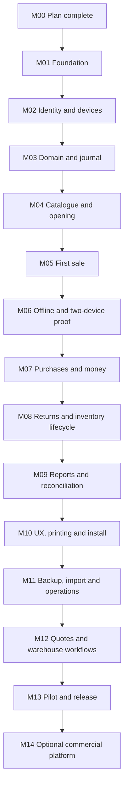

# Delivery roadmap and review gates

M00 is this planning package. Start M01 only after reading the shared contracts. Each milestone has one primary branch/PR and a copy-ready prompt. Split a large milestone into sequential PRs when necessary, but do not report its acceptance gate complete until the complete vertical behaviour works.

| ID | Deliverable | Required exit evidence | Agent prompt |
| --- | --- | --- | --- |
| M00 | Product map, specs, diagrams and prompts | Linked planning package; no implementation claim | Planning complete |
| M01 | Workspace, CI, database/dev setup, original responsive shell | Fresh install, lint/typecheck/build; shell at target viewports | [01](../../prompts/01-foundation.md) |
| M02 | Username login, businesses, memberships, device enrolment and local-store bootstrap | Real DB tenant isolation; correct username payload; permission-filtered bootstrap | [02](../../prompts/02-identity-and-devices.md) |
| M03 | Exact calculation engine, journal, source events and command transaction skeleton | Golden/property tests; balanced commit guard; replay/rollback tests | [03](../../prompts/03-domain-and-journal.md) |
| M04 | Items, parties, units, accounts and opening balances | Persisted CRUD/archive, ownership constraints and opening reconciliation | [04](../../prompts/04-catalogue-and-opening.md) |
| M05 | First complete online sale with receipt | User creates real bill; journal/stock/payment reconcile; retry is safe | [05](../../prompts/05-first-sale.md) |
| M06 | Real offline issue and multi-device sync | Offline/reload/two-context convergence; dropped ACK, commit-order cursor and failure matrix | [06](../../prompts/06-offline-and-sync.md) |
| M07 | Purchases, expenses, standalone payments/allocations and accounts | Supplier/party/account books reconcile; defined additional offline commands | [07](../../prompts/07-purchases-and-money.md) |
| M08 | Credits/refunds, inventory counts and deficit valuation | Concurrent limits and source-cost corrections; no financial hard delete | [08](../../prompts/08-returns-and-stock.md) |
| M09 | Reports, reconciliation and cash close | Mixed-fixture trial balance, P&L, stock, dues; freshness/late-entry evidence | [09](../../prompts/09-reports-and-reconciliation.md) |
| M10 | Complete responsive UX, print templates and PWA installation | 1366/1920/mobile journeys; print/PDF QA; actual hardware matrix recorded | [10](../../prompts/10-ux-print-and-install.md) |
| M11 | Backups, isolated restore, CSV import/export and deployment tooling | Restore drill, epoch fencing, import replay and fresh-host runbook | [11](../../prompts/11-backup-import-and-operations.md) |
| M12 | Quotes, purchase orders and warehouse transfer | Partial conversion/receipt concurrency; transit reconciliation | [12](../../prompts/12-orders-and-warehouses.md) |
| M13 | Controlled pilot and release assessment | Real-workday checklist, unresolved blockers, recovery proof and explicit go/no-go | [13](../../prompts/13-pilot-and-release.md) |
| M14 | Optional commercial SaaS layer | Separate approved product decision; real entitlement/provider lifecycle | [14](../../prompts/14-optional-commercial-platform.md) |

### Implementation dependencies

[Editable source](../diagrams/17-milestone-dependencies.mmd)

## Release gates

| Gate | Earliest milestone | Meaning |
| --- | --- | --- |
| UI prototype | M01 | Navigation and visual shell only; no business claims |
| Online vertical slice | M05 | One complete persisted sale; still not a business release |
| Offline feasibility | M06 | Critical offline/multi-device contract proven before feature expansion |
| Core pilot candidate | M11 | Operational core complete, subject to M13 verification; M12 modules can remain disabled |
| Extended pilot candidate | M12 | Orders and warehouse workflows added |
| Production candidate | M13 | Only the tested/enabled scope, after blocker review and explicit deployment authority |

## Working loop

1. Start from latest merged base; inspect status and applicable instructions. Never build the next stage on an unmerged stale branch accidentally.
2. Read contract and one prompt. Record any necessary departure before changing a shared contract.
3. Implement working UI + API + persistence for the selected behaviour. A mocked chart or button is not a completed workflow.
4. Run milestone checks, including real persistence and failure tests where specified. Add UI screenshots and concise reproducible evidence.
5. Push branch and open PR. Include migrations, command output, limitations and next eligible milestone. Update actual status only with evidence.
6. Review and merge through the user's process, then continue with the next prompt. Do not automatically merge/deploy from a generic milestone prompt.

## Dependency and scope discipline

Do not build reports from a local-only array to make M09 look finished. Do not defer money/stock integrity until after a polished interface. Do not call M06 complete with read-only cache. Keep each milestone's UI quality reasonable from the start; M10 is verification/polish, not permission to leave earlier screens unusable.

M12 may be deferred for a core-only pilot by an explicit scope decision recorded in PROJECT_STATUS.md. M14 is not a launch prerequisite for an owner-operated product. Additional features from the proposal backlog need selected requirements and their own milestones. Estimate remaining effort after M05/M06 using measured complexity; this plan deliberately avoids invented delivery dates.
