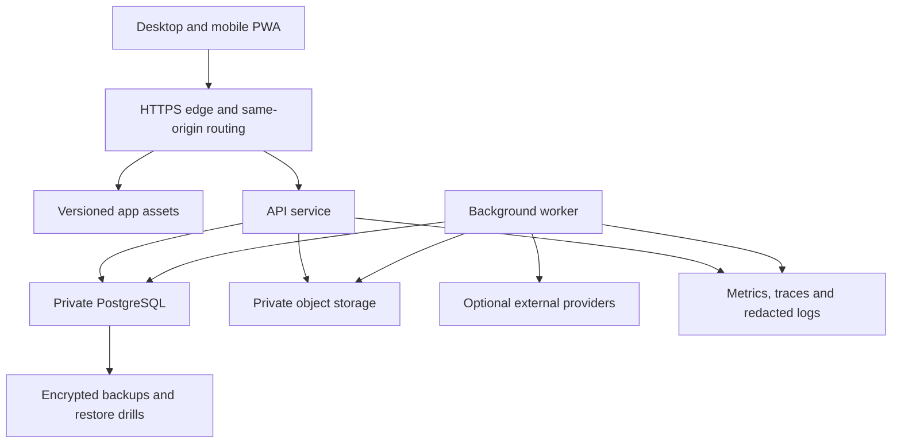

# Deployment, backup and operations

## Initial topology

Use one production origin over HTTPS for the web app and API routing, a managed or properly operated PostgreSQL instance on private networking, a worker from the same repository, and private object storage for attachments/archives. Choose provider/region after measuring pilot needs, budget and backup requirements. No provider price or free-tier durability is assumed in this plan.

### Production deployment boundary

[Editable source](../diagrams/24-deployment.mmd)

## Environments and startup

- Separate development, staging and production data/secrets. Demo fixtures run only by an explicit non-production command.
- Provide a repeatable local environment with PostgreSQL, documented env schema and a non-secret .env.example.
- Build immutable app/API/worker images or equivalent versioned artefacts; run as a restricted user and expose only required services.
- Apply checksum-tracked migrations with a single migration lock before starting the new application. Fail on missing/invalid configuration. Never auto-reset the database to make startup pass.
- Expose liveness, readiness and a separately monitored worker heartbeat. Readiness reflects required DB/schema compatibility; never reveal credentials or full errors publicly.
- Configure proxy trust, request/body limits, TLS, cookies, CSP, upload budgets, logs and backup permissions for the actual deployment.
- Verify backup before risky migrations. Prefer forward-compatible additive migrations; rollback app code only while schemas/queued command versions remain compatible. For incompatible data changes use rehearsed recovery, not destructive down migrations.

## Three different recovery artefacts

| Artefact | Contains | Does not contain |
| --- | --- | --- |
| Operator database backup | Consistent cloud database and separately tracked object storage | Work never uploaded from a device |
| Owner business export/archive | Authorised single-business records, attachments, manifest, totals, epoch and idempotency/number registries | Other businesses or live auth sessions/secrets |
| Device recovery bundle | Encrypted pending commands, issued snapshots, local counters/enrolment metadata, versions and dependencies | A guarantee of full company data or automatic cloud acceptance |

A downloaded CSV is not a complete backup. A cloud backup cannot recover a bill that only existed on a lost device. A recovery bundle must not be automatically replayed as fresh transactions into a restored dataset.

## Backup policy proposal

Use provider-supported continuous/PITR backup if available, plus encrypted daily snapshots and independently verified object manifests. Proposed initial service targets: cloud RPO 24 hours without PITR, RTO 4 hours for the pilot-sized dataset; improve only after measurement/provider guarantees. Device-unsynced work has no cloud RPO. Retention proposal: 7 daily, 4 weekly and 12 monthly snapshots, subject to storage budget and selected record-retention obligations. No legal retention claim is made.

Verify checksums, decryptability, logical counts, trial balance, stock value and attachment availability in scheduled restore drills. Monitor backup age, failures, worker lag and disk/storage capacity. Store encryption recovery material separately with an explicit owner/operator recovery process.

## Isolated restore and epoch fence

1. Authenticate owner and recheck sensitive authority. Upload/choose archive into a private restore job, not a public static path.
2. Validate manifest/version/checksums/size before extraction. Restore to an isolated recovery business/namespace and reconcile rows, accounts, stock, documents, number registries and attachments.
3. Present a concrete preview of differences, current business activity and pending devices. Default action is inspection; promotion is explicit and audited.
4. For promotion, fence writes, revoke sessions/leases, advance dataset epoch and update the active dataset atomically. Preserve the superseded dataset and rollback plan.
5. Old device tokens/cursors/commands carry an incompatible epoch and cannot post. Devices take a new scoped snapshot and receive a fresh enrolment/number prefix. Preserve old pending bundles for owner reconciliation.
6. Reconcile old issued work manually against recovered command/effect registries. Preserve original command/document identities when adopting work through a dedicated reviewed recovery path. Never reissue it as a new sale just to clear the queue.

Restore is therefore available without silently overwriting current work. Any process that can lose accepted transactions must present its concrete scope and require explicit owner selection in the product.

## Monitoring and incident runbooks

Track request latency/error rate, DB connections/locks, sync accepted/held/retry counts, stale-device age, queue depth, unvalued deficits, journal-balance guard failures, worker lag and backup age. Use business-safe IDs and redacted logs. Alerts for unreconciled money/stock should be actionable, not merely infrastructure uptime.

Document procedures for lost billing device, revoked employee, expired cursor, failed app upgrade, stuck issued bill, wrong import, provider outage, printer failure and failed migration. Printing failure must not create another sale; reprint the saved document.

## Import and portability

Item/party CSV imports support column mapping, dry run, row-level errors, explicit duplicate strategy and idempotent batch identity. Opening balances are a separate financial import requiring preview and reconciliation. Do not import arbitrary historical documents as editable balance totals. Export role-permitted data with source/freshness metadata and formula-safe CSV output.

Do not claim direct Vyapar backup compatibility without a documented, permitted format and mapping test. Start with generic CSV templates; richer migration needs actual sample data and a separate tested scope.
