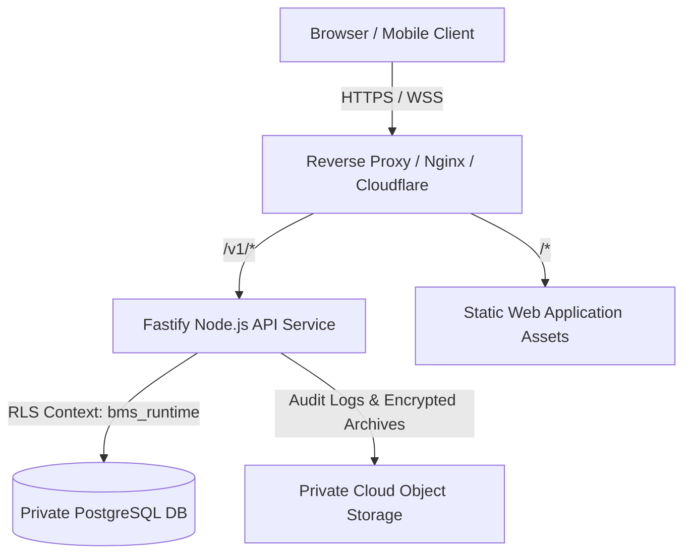

# Operational Runbook: Deployment & Operations

## 1. System Topology & Architecture

The application runs as a cohesive modular monolith with an online-first architecture:
- **Frontend SPA**: React + Vite static bundle served over HTTPS same-origin.
- **Backend API**: Fastify / Node.js 22 server exposing RESTful endpoints under `/v1/`.
- **Database**: PostgreSQL 16+ with Row-Level Security (RLS) and tenant composite keys `(business_id, id)`.
- **Restricted Database Role**: The application connects under `bms_runtime`, which has strict RLS policies enabled and cannot bypass tenant boundaries.



---

## 2. Environment Configuration & Secret Hygiene

Environment variables are validated strictly on startup:
- `DATABASE_URL`: Connection string with `bms_runtime` user credentials.
- `DATABASE_ADMIN_URL`: Dedicated connection string for locked migrations (`bms_owner` / superuser).
- `SESSION_SECRET`: High-entropy 64-character secret for authenticated session cookie signing.
- `LEASE_SECRET`: Secret key for device lease generation.
- `NODE_ENV`: Must be `production` in live deployments.
- `PORT`: HTTP listener port (default `3000`).

Never store unencrypted production passwords, session cookies, or CSRF tokens in git or public object storage.

---

## 3. Database Migration Deployment Runbook

Migrations are managed with Prisma Migrate and applied before application processes boot:
1. **Pre-Deployment Check**:
   ```bash
   pnpm db:status
   ```
2. **Apply Migrations with Advisory Lock**:
   ```bash
   DATABASE_URL="$DATABASE_ADMIN_URL" pnpm --filter @business/db exec prisma migrate deploy
   ```
3. **Verify Runtime Role Permissions**:
   Ensure newly created tables grant `SELECT, INSERT, UPDATE, DELETE` to `bms_runtime` and have `FORCE ROW LEVEL SECURITY` applied.

---

## 4. Health & Readiness Monitoring

- **Liveness Probe**: `GET /healthz`
  - Returns HTTP 200 `{ status: "ok", timestamp: "..." }`.
  - Probes process event loop health.
- **Readiness Probe**: `GET /readyz`
  - Executes `SELECT 1` against PostgreSQL pool.
  - Returns HTTP 200 `{ ready: true, database: "ok" }`.
  - Returns HTTP 503 if database connectivity fails or connection pool is exhausted.
